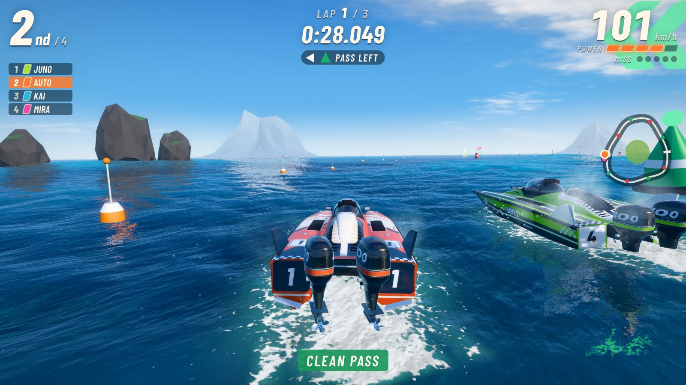
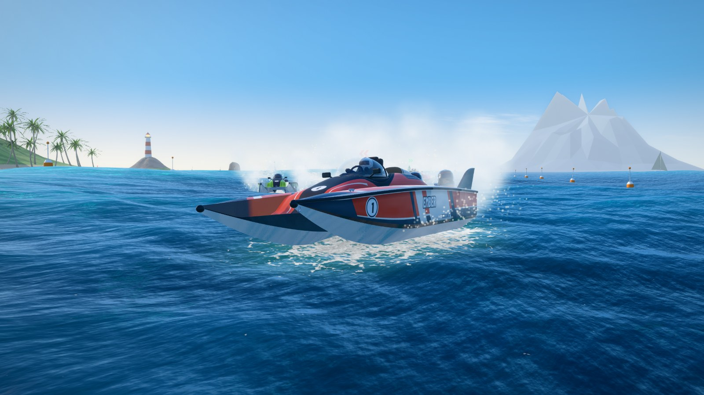
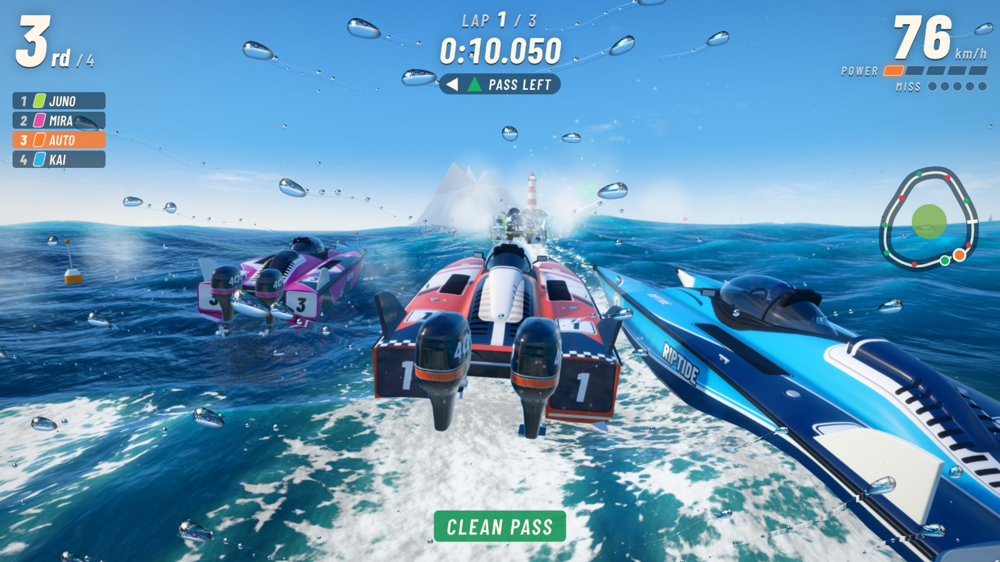
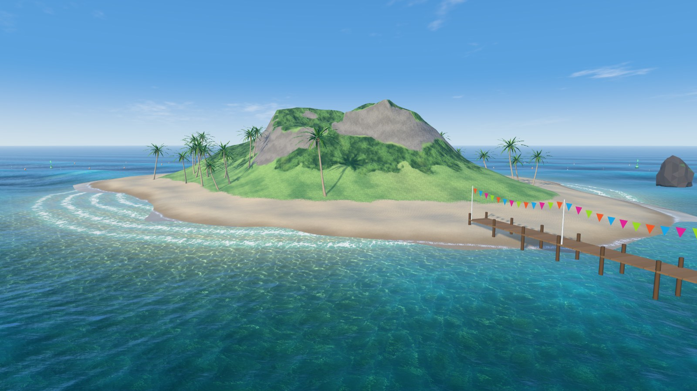
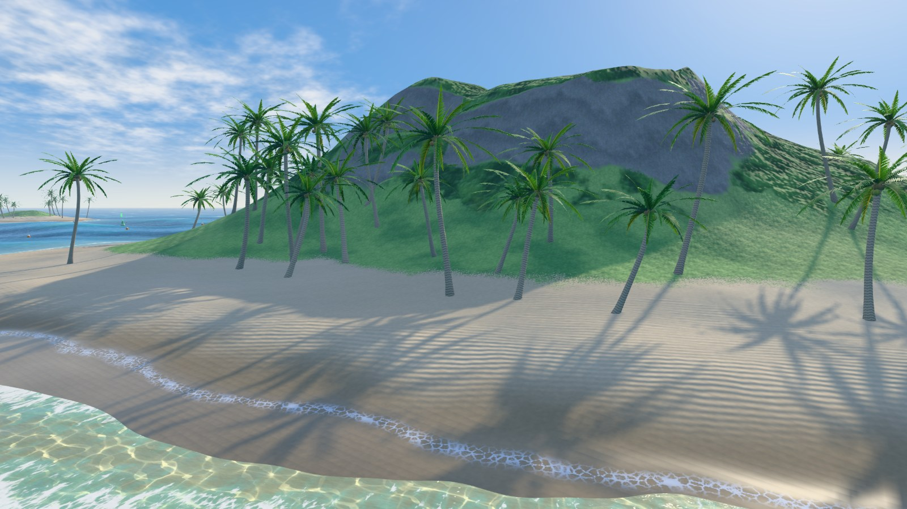
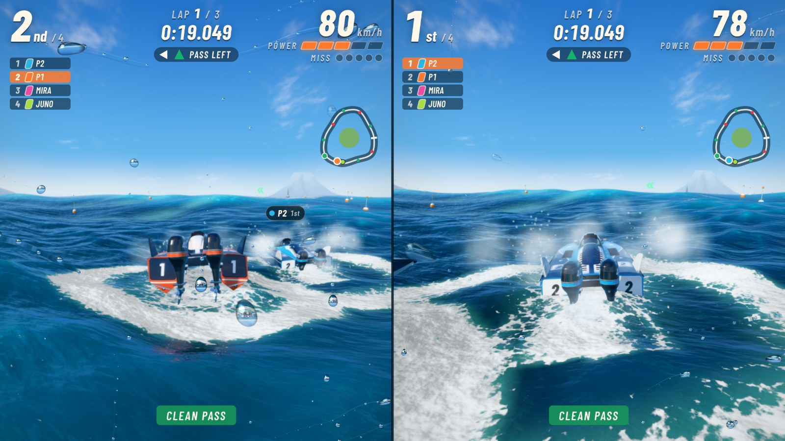

# Breakwater GP

An original powerboat slalom race for the browser, built with
[three.js](https://threejs.org). One island circuit, three laps, four race
boats, and a simulated sea that the boats genuinely ride on. Everything you see
and hear is generated in code: there are no model, texture or audio files.

Race alone against three bots, or against friends: split screen on one
keyboard, or online with up to four players and no game server.

**▶ Play it: https://coderitual.github.io/ai-lab/01-breakwater-gp/**


| | |
| --- | --- |
|  |  |
|  |  |
|  |  |
|  |  |
|  |  |

## What is in it

- **A sea you can read.** One set of waves drives both the picture and the
  physics, so the crest you see is the crest that launches you. Rough on the
  ocean side of the island, calmer in its lee.
- **Race boats modelled and painted in code**: tunnel-hull catamarans, each
  team's to its own design, with numbers and lettering, a driver under glass,
  twin outboards that swing with the helm.
- **Handling with weight in it**: the boat lies on four points of buoyancy,
  so it pitches, rolls and lands as the sea makes it; lean on the helm and
  the hulls let go into a drift.
- **Reflections**: the paintwork and glass mirror the real surroundings as
  they go by; the water mirrors the boats, the marks and the island.
- **Water that behaves**: light through the wave tops, caustics, foam that
  lingers behind breaking crests, wakes that age from white water to lace,
  spray plumes, and rain running across the camera lens when you sit in
  somebody's spray.
- **An island worth looking at**: rippled sand that goes dark and glossy at
  the water's edge, a forested hill, coconut palms swaying over their own
  long shadows.
- **Multiplayer**: split screen, and online for up to four with no server:
  browsers connect directly, and you pass the invite along in any chat app.
- **Phones**: one thumb is enough. Written for iPhone Safari.

## Run it

```bash
npm install
npm run dev        # http://localhost:5173 — also served on your LAN, so you can open it from a phone
npm run build      # static site in dist/  (relative paths: host it anywhere)
npm run preview    # serve the production build
```

## How to play

Three ways to race, chosen on the title screen:

- **Solo**: you against three bots.
- **Two players, split screen**: two drivers on one keyboard, each with their
  own half of the screen, plus two bots. Player 1 uses `W` `A` `S` `D`,
  player 2 the arrow keys. Each driver's engines, chimes and splashes come from
  their side of the stereo picture (headphones or two speakers help).
- **Online, two to four players**: one driver per device, bots in the empty
  seats, and no game server. See [Online play](#online-play) below.

Solo controls:

|            | Keyboard            | Phone                                   |
| ---------- | ------------------- | --------------------------------------- |
| Steer      | `←` `→` (or `A` `D`) | touch anywhere and drag sideways        |
| Throttle   | `↑` (or `W`)         | automatic                               |
| Brake      | `↓` / `S` / `Space`  | pull that thumb down, or hold a second finger anywhere |
| Start      | `Enter` or the button | tap the button                         |
| Sound      | `M` or the link on the panels | the link on the panels         |

On a phone one thumb is enough: wherever it lands, a stick appears under it.

The slalom marks follow real lateral marks:

- **Red can** (flat top): pass on its **right**.
- **Green cone** (pointed top): pass on its **left**.

Each clean pass adds one level of **power** (up to five) and with it top speed.
A miss drops power to zero and counts toward five allowed misses; the fifth
puts you out. Stay inside the orange floats: after five seconds outside you are
put back on course without power.

Hitting the swell head-on at speed throws the boat into the air; you cannot
steer or drive in the air, and a hard landing costs speed.

## Online play

Up to four players on their own devices, and no game server in between: the
browsers connect straight to each other (WebRTC). All they need from you is
help finding each other, which takes two messages per friend in any chat app.

1. **You** (the host): *2–4 players online → Invite friends*, then send the
   invite link to a friend.
2. **Your friend**: opens the link, gets a reply code, sends it back.
3. **You**: paste the reply code and press *Connect*. Their name appears in
   the seat list, and a fresh invite is ready for the next friend.
4. Repeat for up to three friends, then *Start race*. Bots take the seats
   nobody claimed.

Everyone drives their own boat on their own device, so the controls never wait
for the network. All devices keep one shared clock, so the waves, the start
lights and the timing are the same on every screen. After the flag the host
can start a rematch, or go back to the lobby to invite more players.

### If there is no server, what does the work?

- **GitHub Pages** only hands out the game's files. It never sees a race.
- **You** are the matchmaker. The invite and the reply are each browser's
  "this is how to reach me" note (network addresses and an encryption
  fingerprint), which a signalling server would normally pass along. Here you
  pass them along by chat.
- **STUN servers** (public ones run by Google and Cloudflare) answer one
  question while a note is being written: "what is my address as seen from the
  internet?". No game data goes through them.
- **The host's browser** is the nearest thing to a server once the race is on:
  it runs the bots, starts the races, and passes each guest's position on to
  the other guests. Guests are linked to the host only.
- Everything in a race travels directly between the browsers, encrypted.

Good to know:

- Keep the page open while you swap the two messages. Reloading or closing it
  makes the invite or the reply worthless, and each can be used once.
- The link and the code contain network addresses. Send them to the people you
  are playing with, not to a public channel.
- There is no relay to fall back on, so two devices that both sit behind strict
  networks (some office, campus and mobile-carrier networks) may not be able
  to connect. The game says so after about 25 seconds; home Wi-Fi or a phone
  hotspot usually works.
- If the host leaves, the race is over for everyone; if a guest leaves, the
  others race on.
- Open the game from its public address. Embedded previews that block WebRTC
  cannot connect.

## Documentation

Everything about how it works is in [`docs/`](docs/):

| | |
| --- | --- |
| [design.md](docs/design.md) | what the game is meant to be, and why |
| [spec.md](docs/spec.md) | what the build does, number by number |
| [techniques.md](docs/techniques.md) | how the tricky parts work: sea, foam, reflections, handling, rain on the lens, the island, netcode, test rigs |
| [boat.md](docs/boat.md) | the boat: lines, texture sheet, materials, how to change them |
| [tools.md](docs/tools.md) | dev scripts, tests, and what has and has not been verified |
| [ideas.md](docs/ideas.md) | what to do next |

The pictures on this page and in the docs are generated: `node
tools/screenshots.cjs` remakes all of them (see
[docs/README.md](docs/README.md#keeping-this-current)).

## Layout

```
src/
  engine/   loop, the sea, camera, input, sound, reflections (knows nothing of this game)
  assets/   everything visible, generated: sky, water, the boat, marks, islands
  game/     track, rules, boat physics, bots, effects, HUD, and Game.js to wire it up
  net/      online play: WebRTC links joined by hand-carried codes, shared clock, prediction
tools/      dev scripts (need Playwright): tests, captures, screenshots
docs/       design, spec, techniques, pictures
```

## Tests

```bash
npm run build && npm run preview &
node tools/playtest.cjs http://localhost:4173/     # solo + split screen: input, rules, panels
node tools/soundtest.cjs http://localhost:4173/    # sound: every cue, its moment and its side
node tools/nettest.cjs http://localhost:4173/      # online: two to four pages join and race
```

They run in headless Chromium. What they cover, and what nobody has checked
yet (real phones, real Safari, real networks), is in
[docs/tools.md](docs/tools.md#what-has-been-verified).
