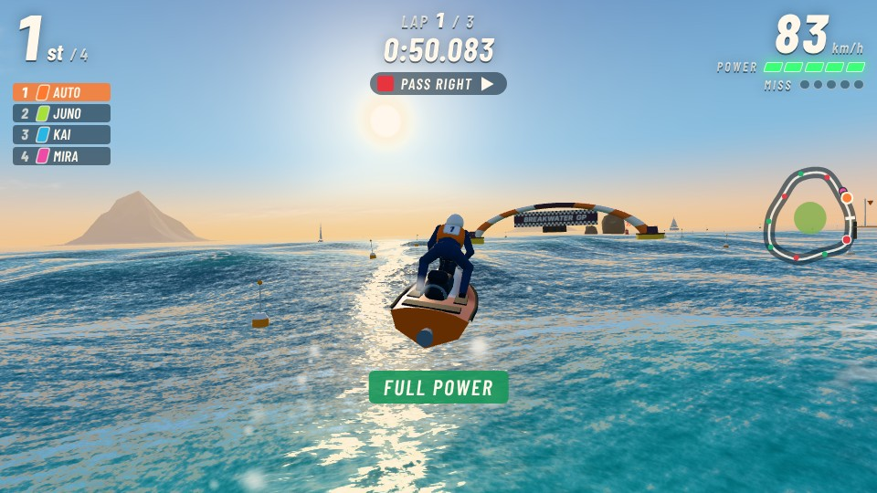

# Breakwater GP

A small, original jet-ski slalom racing demo for the browser, built with
[three.js](https://threejs.org). One island circuit, three laps, four crafts,
a simulated sea that the crafts genuinely ride on. Everything you see is
generated in code: there are no model, texture or audio files.

Race alone against three bots, or against a friend: split screen on one
keyboard, or online from two devices with no game server.

It runs on desktop (keyboard) and on phones (touch), and is written for iPhone Safari.

**▶ Play it: https://coderitual.github.io/ai-lab/01-breakwater-gp/**




## Run it

```bash
npm install
npm run dev        # http://localhost:5173 — also served on your LAN, so you can open it from a phone
npm run build      # static site in dist/  (relative paths: host it anywhere)
npm run preview    # serve the production build
```

## How to play

Three ways to race, chosen on the title screen:

- **Solo**: you against three bots.
- **Two players, split screen**: two riders on one keyboard, each with their
  own half of the screen, plus two bots. Player 1 uses `W` `A` `S` `D`,
  player 2 the arrow keys.
- **Two players, online**: one rider each on two devices, plus two bots, with
  no game server. See [Online play](#online-play) below.

Solo controls:

|            | Keyboard            | Phone                                   |
| ---------- | ------------------- | --------------------------------------- |
| Steer      | `←` `→` (or `A` `D`) | left thumb: press and drag sideways     |
| Throttle   | `↑` (or `W`)         | automatic                               |
| Brake      | `↓` / `S` / `Space`  | right thumb: hold                       |
| Start      | `Enter` or the button | tap the button                         |
| Sound      | `M` or the link on the panels | the link on the panels         |

The slalom marks follow real lateral marks:

- **Red can** (flat top): ride past on its **right**.
- **Green cone** (pointed top): ride past on its **left**.

Each clean pass adds one level of **power** (up to five) and with it top speed.
A miss drops power to zero and counts toward five allowed misses; the fifth
puts you out. Stay inside the orange floats: after five seconds outside you are
put back on course without power.

The sea is rough on the open-ocean side of the island and calmer in its lee.
Hitting the swell head-on at speed throws the craft into the air; you cannot
steer or drive in the air, and a hard landing costs speed.

## Online play

Two players on two devices, and no game server in between: the two browsers
connect straight to each other (WebRTC). All they need from you is help finding
each other, which takes two messages in any chat app.

1. **You**: *2 players online → Invite a friend*, then send the invite link.
2. **Your friend**: opens the link, gets a reply code, sends it back.
3. **You**: paste the reply code, press *Connect*, then *Start race*.

Each of you rides your own craft on your own device, so the controls never wait
for the network; the host's device also runs the two bots. Both devices keep one
shared clock, so the waves, the start lights and the timing are the same on both
screens. After the flag the host can start a rematch on the same link.

Good to know:

- Keep the page open while you swap the two messages. Reloading or closing it
  makes the invite or the reply worthless, and each can be used once.
- The link and the code describe how to reach your browser, network addresses
  included. Send them to the person you are playing with, not to a public channel.
- Public STUN servers (Google's and Cloudflare's) are asked for each device's
  public address. No game data passes through them, and there is no relay to
  fall back on, so two devices that both sit behind strict networks (some
  office, campus and mobile-carrier networks) may not be able to connect. The
  game says so after about 25 seconds; home Wi-Fi or a phone hotspot usually works.
- Open the game from its public address. Embedded previews that block WebRTC
  cannot connect.

## How it is put together

```
src/
  assets/     everything visible, generated with three.js
    palette.js      colour script + sun direction + team colours
    textures.js     tileable noise / ripple / label textures (CPU generated)
    sky.js          sky dome shader, shared sky-fog GLSL, PMREM environment
    water.js        ocean mesh (radial grid) + shader (scattering, foam trails, glitter)
    watercraft.js   lofted hull + trim            rider.js   IK-posed rider
    buoys.js        slalom marks, course floats, start arch
    island.js       analytic low-poly islands     scenery.js palms, rocks, lighthouse, pier, sailboats
    geo.js          modelling helpers (loft, merge, facet, two-bone IK)
  engine/     reusable runtime
    Engine.js       renderer, resize, fixed-timestep loop + interpolation, adaptive resolution
    waves.js        THE sea: one Gerstner wave set used by both the shaders and the physics
    ChaseCamera.js  chase / orbit camera        Input.js   keyboard + multi-touch
    Audio.js        synthesised engine, water and cues (Web Audio)
  game/       this particular game
    track.js        centre line, marks, racing line, grid
    World.js        builds the location from the assets, floats the props
    Craft.js        watercraft physics          drivers.js player + bot drivers
    Race.js         rules: marks, power, misses, laps, ranking, respawn
    effects.js      wake field (render-to-texture foam + shadows), spray particles
    Hud.js / hud.css   DOM HUD (one set of readouts per rider), minimap, panels, online lobby
    Game.js         wires it all together: solo, split screen (two viewports), online
  net/        online play
    PeerLink.js     WebRTC data channels joined by hand-carried codes (no signalling server)
    OnlinePlay.js   lobby flow, shared clock, state messages, prediction of remote crafts
tools/        optional dev scripts (need Playwright): screenshots, frame-stepped capture, play tests
```

A few choices worth knowing about:

- **One sea, two consumers.** `engine/waves.js` defines six trochoidal waves and
  an amplitude field (calm near shores and behind the island). The same
  numbers feed the GLSL (vertex displacement, per-pixel analytic normals) and
  `sampleSurface()` on the CPU (buoyancy, pitch/roll, floating props, camera
  clearance). What you see is what the physics rides. A second tier of short,
  steep chop (under 10 cm high) is drawn by the GPU only: it sharpens the
  surface without touching the handling.
- **Water shading** (`assets/water.js`): a deep-blue body that lightens with
  wave height; sunlight scattering through thin crests and through faces
  turned toward the viewer (the turquoise glow); foam that is laid where the
  swell bunches up and then lingers behind the moving crest, drawn as lacy
  threads over a veil of aerated water; and sun glitter from a normal-map
  lookup held at constant size on screen, so facets sparkle near and far.
- **Craft physics** (`game/Craft.js`) is a one-sided buoyancy spring — water
  pushes up, only gravity pulls down — so jumps fall out of the simulation
  instead of being scripted. Wave faces push the hull downhill, grip and
  thrust fade as the hull leaves the water, and the hull's attitude is fitted
  to four samples of the surface.
- **Fixed 120 Hz simulation, interpolated rendering.** Handling is identical at
  30, 60 or 120 fps.
- **Wake field.** Wakes, hull wash, splash rings and soft craft shadows are drawn
  top-down into a small texture each frame and sampled by the ocean shader, so
  foam lies in the water surface and drifts with it. No geometry floating on top.
- **Cheap to draw.** Static scenery is merged and vertex-coloured, floats are
  instanced, there are no shadow maps or post-processing: about 100 draw calls
  and 170k triangles per frame. Split screen draws the scene twice, each half
  with its own camera, its own dense patch of ocean and its own wake texture.
- **Online without a server.** `net/PeerLink.js` packs each browser's WebRTC
  session description into a text code (deflate + base64url) that the players
  carry by hand; that replaces the signalling server. `net/OnlinePlay.js` then
  runs the race over two data channels:
  - Each machine simulates only its own rider (the host also the bots) and
    reports those crafts 20 times a second on an unreliable channel, where a
    late update is simply dropped.
  - Both machines read one **sea clock**. The guest sets its clock to the
    host's from ping round trips and keeps trimming it by a few milliseconds
    during the race. While a link is up the clock is tied to real time: a
    machine that drops frames or has its tab hidden loses ground on the water,
    not time on the clock, so the two race clocks cannot drift apart.
  - A remote craft is drawn where it should be *now*: its newest report is
    coasted forward on its speed and turn rate, and each correction is blended
    in over a few frames. Its height, pitch and roll are replayed a moment late
    and set onto the local copy of the shared sea.

## Phones

- Canvas pixel ratio is capped at 2 and steps down (at most twice) if the device
  cannot hold about 45 fps.
- Touch input uses Pointer Events with `touch-action: none`; scrolling, pinch
  zoom, double-tap zoom, text selection and long-press callouts are suppressed
  on the game surface. HUD padding respects the safe-area insets.
- Works in both orientations (landscape recommended); the lens widens in portrait.
- Audio starts on the Start tap, as iOS requires, and obeys the ring/silent switch.
- Needs WebGL 2 (iOS 15+).

## Dev tools

These are not part of the build and need Playwright available to Node.

```bash
node tools/shot.cjs --url "http://localhost:5173/viewer.html?asset=craft" --out craft.png   # asset viewer shots
node tools/capture.cjs --url "http://localhost:4173/?auto&ap&manual&dpr=1" --at 9,24,41 --out shots/lap   # stills
node tools/capture.cjs --url "…" --from 46 --seconds 10 --fps 30 --out clip/f                # frames for ffmpeg
node tools/playtest.cjs http://localhost:4173/                                                # solo + split screen: input, rules, panels
node tools/nettest.cjs http://localhost:4173/                                                 # online: two pages join and race
```

Useful query options: `?auto` (skip the title), `?ap` (a bot rides your craft),
`?mode=split`, `?laps=1`, `?dpr=1`, `?sea=0.8` (wave height), `?manual` (step
with `__bw.advance(seconds)` / `__bw.skip(seconds)`), `?nodraw` (run without
rendering), and for online play `?netlag=80&netjitter=40&netloss=5` (hold back
by 80–120 ms, and drop 5 % of, the updates this page receives).

`viewer.html?asset=sea|craft|crafts|world&az=…&el=…&dist=…` shows single assets
over the real sea and sky.

## What was (and was not) verified

Checked with the scripts in `tools/` in headless Chromium (software WebGL):

- **Solo**: a full three-lap bot race, the keyboard path, the touch path on
  iPhone-sized viewports in both orientations (drag steering, two-thumb
  braking, panels fit), the rules (clean pass, miss, off-course reset, five
  misses and out), results and restart, a lost and restored WebGL context, and
  the production build.
- **Split screen**: separate keys per rider, rules and readouts per rider,
  results, rematch, back to the menu.
- **Online**, between two pages of one browser on one machine:
  - the whole flow: invite, reply, wrong or mangled pastes, race, results,
    rematch, one side leaving;
  - a simulated bad link (80–120 ms each way, 5 % of updates lost): the other
    rider is drawn about 0.1 m from where they really are on average and
    under 1 m at worst, without visible snapping, and a 1.5 s stall on one
    machine leaves both clocks in agreement;
  - both pages running in real time: the two sea clocks stay within a few
    milliseconds of each other, also after a 0.7 s hitch.

Not checked:

- Real Safari/WebKit and real phone hardware (only Chromium was available),
  frame rate on a device, and how the synthesised audio sounds.
- Online play between two real devices across the internet. Whether two
  networks let the browsers reach each other (NAT traversal) cannot be tried
  from one machine, and neither can the system share sheet on a phone.
