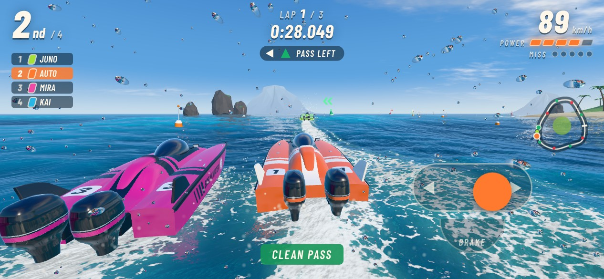

# Breakwater GP

A small, original powerboat slalom racing demo for the browser, built with
[three.js](https://threejs.org). One island circuit, three laps, four race
boats, a simulated sea that the boats genuinely ride on. Everything you see is
generated in code: there are no model, texture or audio files.

Race alone against three bots, or against friends: split screen on one
keyboard, or online with up to four players and no game server.

It runs on desktop (keyboard) and on phones (touch), and is written for iPhone Safari.

**▶ Play it: https://coderitual.github.io/ai-lab/01-breakwater-gp/**




## Run it

```bash
npm install
npm run dev        # http://localhost:5173 — also served on your LAN, so you can open it from a phone
npm run build      # static site in dist/  (relative paths: host it anywhere)
npm run preview    # serve the production build
```

## How to play

Three ways to race, chosen on the title screen:

- **Solo**: you against three bots.
- **Two players, split screen**: two drivers on one keyboard, each with their
  own half of the screen, plus two bots. Player 1 uses `W` `A` `S` `D`,
  player 2 the arrow keys. Each driver's engines, chimes and splashes come from
  their side of the stereo picture (headphones or two speakers help).
- **Online, two to four players**: one driver per device, bots in the empty
  seats, and no game server. See [Online play](#online-play) below.

Solo controls:

|            | Keyboard            | Phone                                   |
| ---------- | ------------------- | --------------------------------------- |
| Steer      | `←` `→` (or `A` `D`) | touch anywhere and drag sideways        |
| Throttle   | `↑` (or `W`)         | automatic                               |
| Brake      | `↓` / `S` / `Space`  | pull that thumb down, or hold a second finger anywhere |
| Start      | `Enter` or the button | tap the button                         |
| Sound      | `M` or the link on the panels | the link on the panels         |

On a phone one thumb is enough: wherever it lands, a stick appears under it.
The camera sits low and close behind the boat. In multiplayer every other
boat carries a name tag with its driver's place, and online their ping.

The slalom marks follow real lateral marks:

- **Red can** (flat top): pass on its **right**.
- **Green cone** (pointed top): pass on its **left**.

Each clean pass adds one level of **power** (up to five) and with it top speed.
A miss drops power to zero and counts toward five allowed misses; the fifth
puts you out. Stay inside the orange floats: after five seconds outside you are
put back on course without power.

The sea is rough on the open-ocean side of the island and calmer in its lee.
Hitting the swell head-on at speed throws the boat into the air; you cannot
steer or drive in the air, and a hard landing costs speed.

## Online play

Up to four players on their own devices, and no game server in between: the
browsers connect straight to each other (WebRTC). All they need from you is
help finding each other, which takes two messages per friend in any chat app.

1. **You** (the host): *2–4 players online → Invite friends*, then send the
   invite link to a friend.
2. **Your friend**: opens the link, gets a reply code, sends it back.
3. **You**: paste the reply code and press *Connect*. Their name appears in
   the seat list, and a fresh invite is ready for the next friend.
4. Repeat for up to three friends, then *Start race*. Bots take the seats
   nobody claimed.

Everyone drives their own boat on their own device, so the controls never wait
for the network. All devices keep one shared clock, so the waves, the start
lights and the timing are the same on every screen. After the flag the host
can start a rematch, or go back to the lobby to invite more players.

### If there is no server, what does the work?

- **GitHub Pages** only hands out the game's files. It never sees a race.
- **You** are the matchmaker. The invite and the reply are each browser's
  "this is how to reach me" note (network addresses and an encryption
  fingerprint), which a signalling server would normally pass along. Here you
  pass them along by chat.
- **STUN servers** (public ones run by Google and Cloudflare) answer one
  question while a note is being written: "what is my address as seen from the
  internet?". No game data goes through them.
- **The host's browser** is the nearest thing to a server once the race is on:
  it runs the bots, starts the races, and passes each guest's position on to
  the other guests. Guests are linked to the host only.
- Everything in a race travels directly between the browsers, encrypted.

Good to know:

- Keep the page open while you swap the two messages. Reloading or closing it
  makes the invite or the reply worthless, and each can be used once.
- The link and the code contain network addresses. Send them to the people you
  are playing with, not to a public channel.
- There is no relay to fall back on, so two devices that both sit behind strict
  networks (some office, campus and mobile-carrier networks) may not be able
  to connect. The game says so after about 25 seconds; home Wi-Fi or a phone
  hotspot usually works.
- If the host leaves, the race is over for everyone; if a guest leaves, the
  others race on.
- Open the game from its public address. Embedded previews that block WebRTC
  cannot connect.

## How it is put together

```
src/
  assets/     everything visible, generated with three.js
    palette.js      colour script + sun direction + team colours
    textures.js     tileable noise / ripple / caustic / label textures (CPU generated)
    sky.js          sky dome shader, shared sky-fog GLSL, PMREM environment
    water.js        ocean mesh (radial grid) + shader (light through the waves, caustics, reflections, foam trails, glitter)
    boat.js         tunnel-hull race boat: lofted hulls, canopy, outboards, painted livery
    buoys.js        slalom marks, course floats, start arch
    island.js       analytic low-poly islands     scenery.js palms, rocks, lighthouse, pier, sailboats
    geo.js          modelling helpers (loft, merge, facet)
  engine/     reusable runtime
    Engine.js       renderer, resize, fixed-timestep loop + interpolation, adaptive resolution
    waves.js        THE sea: one Gerstner wave set used by both the shaders and the physics
    ChaseCamera.js  chase / orbit camera        Input.js   keyboard + multi-touch
    ReflectionProbe.js  live cube map of the surroundings, mirrored by the boats' paintwork
    WaterMirror.js  boats, marks and land mirrored in the water (planar reflection)
    Audio.js        synthesised engines, water and cues (Web Audio), one voice per driver
  game/       this particular game
    track.js        centre line, marks, racing line, grid
    World.js        builds the location from the assets, floats the props
    Craft.js        boat physics                drivers.js player + bot drivers
    Race.js         rules: marks, power, misses, laps, ranking, respawn
    effects.js      wake field (render-to-texture foam + shadows), spray particles
    LensDrops.js    water drops on the camera lens
    Hud.js / hud.css   DOM HUD (one set of readouts per driver), minimap, panels, online lobby
    Game.js         wires it all together: solo, split screen (two viewports), online
  net/        online play
    PeerLink.js     WebRTC data channels joined by hand-carried codes (no signalling server)
    OnlinePlay.js   lobby flow, shared clock, state messages, prediction of remote crafts
tools/        optional dev scripts (need Playwright): screenshots, frame-stepped capture with sound, play and sound tests
```

A few choices worth knowing about:

- **One sea, two consumers.** `engine/waves.js` defines six trochoidal waves and
  an amplitude field (calm near shores and behind the island). The same
  numbers feed the GLSL (vertex displacement, per-pixel analytic normals) and
  `sampleSurface()` on the CPU (buoyancy, pitch/roll, floating props, camera
  clearance). What you see is what the physics rides. A second tier of short,
  steep chop (under 10 cm high) is drawn by the GPU only: it sharpens the
  surface without touching the handling.
- **Water shading** (`assets/water.js`): a deep body that lightens with wave
  height; sunlight coming *through* the water where a wave is thin and where
  you look sunward into its face (the turquoise glow); caustics drifting inside
  that glow, and sharp on the sand where the water is shallow enough to see
  the bottom; foam that is laid where the swell bunches up and then lingers
  behind the moving crest, drawn as lacy threads over a veil of aerated water;
  and sun glitter from a normal-map lookup held at constant size on screen.
- **Caustics made the way they are made** (`assets/textures.js`): a grid of
  rays is bent by the slopes of a periodic ripple field and collected where it
  lands. Where neighbouring rays cross, light piles up into the familiar net.
  Two copies of that texture slide over each other in the shader.
- **The boats** (`assets/boat.js`) are tunnel-hull race catamarans, 5.8 m
  long: two slim hulls ending in pointed bows, a cambered centre body between
  them with the tunnel open underneath, a glass canopy, and two outboards
  that swing with the helm. Each body is a cross-section swept from stern to
  bow. It is split into strips where a real hull has a hard edge (keel, chine,
  spray rail, gunwale) and kept as one smooth skin where it is rounded (decks,
  centre body, canopy, engine cowls), because glossy paint shows every crease.
  Paint lines are kept crisp by placing two sections a few millimetres apart
  on either side of each line; numbers and lettering are small textures laid
  on patches that follow the hull.
- **Reflections, two kinds.**
  - *On the boats* (`engine/ReflectionProbe.js`): a small cube map of the
    surroundings is redrawn from the player's boat, one face per frame, and
    every boat's paint, glass and engine cowls mirror it as a glossy top coat
    over the lit paint, strongest at glancing angles. So what slides over the
    bodywork is the real scene: the horizon, the sun, the wake, the marks, the
    other boats. The sea in that map is a stand-in with a twentieth of the
    triangles.
  - *In the water* (`engine/WaterMirror.js`): the sea already mirrors the sky
    (computed, not drawn). Whatever stands on it — boats, marks, the arch, the
    island — is drawn once more per view from a camera mirrored below the
    surface (sea and sky left out, half size), and the water shader looks each
    of its pixels up in that picture. Ripples tilt the mirror, which slides
    the image mostly up and down the screen: that is what draws reflections
    out into streaks. A mirror image needs one plane; it is put at the height
    of the water under the view's own boat.
- **Boat physics** (`game/Craft.js`) is a one-sided buoyancy spring — water
  pushes up, only gravity pulls down — so jumps fall out of the simulation
  instead of being scripted. Wave faces push the hull downhill, grip and
  thrust fade as the hull leaves the water, and the hull's attitude is fitted
  to four samples of the surface, a hull length apart. For collisions a hull
  is three circles in a row.
- **Fixed 120 Hz simulation, interpolated rendering.** Handling is identical at
  30, 60 or 120 fps.
- **Wake field.** Wakes, hull wash, splash rings and soft craft shadows are drawn
  top-down into a small texture each frame and sampled by the ocean shader, so
  foam lies in the water surface and drifts with it. No geometry floating on top.
  The texture also carries how *fresh* the churn is: straight from the
  propellers it is solid white water; as the air escapes, the same bubble pattern is cut by a
  rising threshold and opens into lace, then flecks, while the band widens and
  its two edges outlast the middle. Churned water is also rougher, so it stops
  mirroring the sky.
- **Water on the lens** (`game/LensDrops.js`). Landings, bumps and a rooster
  tail followed too closely throw drops onto the camera. Each drop is drawn as
  a small lens over a copy of the frame just rendered: the scene upside down
  and squeezed inside it, a glint and a dark rim. Small drops sit and dry; big
  ones are pushed outward by the airflow at speed (or run down at a
  standstill), stretch, swallow the small ones in their way and leave beads
  behind. Nothing is copied or drawn while the lens is dry, and the effect
  switches itself off on a device that is already dropping resolution.
- **Kept affordable.** Static scenery is merged and vertex-coloured, floats are
  instanced, a boat is seven draw calls, and there are no shadow maps or
  post-processing. A solo frame is three passes — one face of the reflection
  map, the mirror image, the view — about 130 draw calls and 450k triangles in
  all. Split screen draws a mirror image and a view per half, each with its
  own camera, its own dense patch of ocean and its own wake texture.
- **Sound without files.** `engine/Audio.js` synthesises everything: each driver
  on the machine gets a voice (three oscillators through a low-pass that opens
  with the revs, plus filtered noise for the water), and one-off tones and
  noise bursts mark the start, clean passes, misses, laps and landings. In
  split screen the two voices are panned to their driver's half of the screen,
  the second boat's engines run 7 % higher so the two do not blur into one, and
  each driver's cues are panned with them. The start signals stay in the middle.
- **Online without a server.** `net/PeerLink.js` packs each browser's WebRTC
  session description into a text code (deflate + base64url) that the players
  carry by hand; that replaces the signalling server. `net/OnlinePlay.js` then
  runs the race over two data channels per friend:
  - The links form a star: each guest is linked to the host only (anything
    else would mean swapping codes between every pair of players), and the
    host passes each guest's reports on to the other guests.
  - Each machine simulates only its own boat (the host also the bots) and
    reports those crafts 20 times a second on an unreliable channel, where a
    late update is simply dropped.
  - Both machines read one **sea clock**. The guest sets its clock to the
    host's from ping round trips and keeps trimming it by a few milliseconds
    during the race. While a link is up the clock is tied to real time: a
    machine that drops frames or has its tab hidden loses ground on the water,
    not time on the clock, so the two race clocks cannot drift apart.
  - A remote craft is drawn where it should be *now*: its newest report is
    coasted forward on its speed and turn rate, and each correction is blended
    in over a few frames. Its height, pitch and roll are replayed a moment late
    and set onto the local copy of the shared sea.

## Phones

- Canvas pixel ratio is capped at 2 and steps down (at most twice) if the device
  cannot hold about 45 fps. The reflections go the same way: on a phone the
  reflection map is 128 px and redrawn every other frame and the water's
  mirror image is drawn at 0.4 scale; the mirror image is given up at the
  first step down, the reflection map and the lens drops at the second.
- One-hand touch control: the first finger down becomes a stick wherever it
  lands (sideways steers, a pull down brakes, both follow the thumb so a
  change of direction answers at once); a second finger is a brake too.
- Touch input uses Pointer Events with `touch-action: none`; scrolling, pinch
  zoom, double-tap zoom, text selection and long-press callouts are suppressed
  on the game surface. HUD padding respects the safe-area insets.
- Works in both orientations (landscape recommended); the lens widens in portrait.
- Audio starts on the Start tap, as iOS requires, and obeys the ring/silent switch.
- Needs WebGL 2 (iOS 15+).

## Dev tools

These are not part of the build and need Playwright available to Node.

```bash
node tools/shot.cjs --url "http://localhost:5173/viewer.html?asset=craft" --out craft.png   # asset viewer shots
node tools/capture.cjs --url "http://localhost:4173/?auto&ap&manual&dpr=1" --at 9,24,41 --out shots/lap   # stills
node tools/capture.cjs --url "…" --from 46 --seconds 10 --fps 30 --out clip/f                # frames for ffmpeg
node tools/playtest.cjs http://localhost:4173/                                                # solo + split screen: input, rules, panels
node tools/nettest.cjs http://localhost:4173/                                                 # online: two to four pages join and race
node tools/soundtest.cjs http://localhost:4173/ wavs/                                         # sound: every cue, its moment and its side
```

A recording with sound, straight to a file (needs `ffmpeg`):

```bash
node tools/capture.cjs --url "http://localhost:4173/?mode=split&manual&dpr=1" --drive --seconds 40 --out clip/f --sound --mp4 clip/split.mp4
```

Software WebGL draws a frame far slower than it plays, so neither the picture
nor the sound can be recorded in real time. The game is stepped frame by frame
instead, and for the sound the page is handed an `OfflineAudioContext` whose
clock is the game clock (`tools/soundcap.cjs`): the game's audio code runs
unchanged and the whole soundtrack is rendered at the end, in step with the
frames. `--drive` lets bots drive for the players, who keep their names.

Useful query options: `?auto` (skip the title), `?ap` (a bot drives your boat),
`?mode=split`, `?laps=1`, `?dpr=1`, `?sea=0.8` (wave height), `?drops=0` (no
water on the lens), `?reflect=0` (no live reflections), `?manual` (step
with `__bw.advance(seconds)` / `__bw.skip(seconds)`), `?nodraw` (run without
rendering), and for online play `?netlag=80&netjitter=40&netloss=5` (hold back
by 80–120 ms, and drop 5 % of, the updates this page receives).

`viewer.html?asset=sea|craft|crafts|world&az=…&el=…&dist=…` shows single assets
over the real sea and sky (`&flat&sea=0.05` holds a boat level on a near-calm
patch, to look at the model itself).

## What was (and was not) verified

Checked with the scripts in `tools/` in headless Chromium (software WebGL):

- **Solo**: a full three-lap bot race in the boats (about 2 min 40 s, no missed
  marks, hulls in the water except for the sixth of the time they are in the
  air), the keyboard path, the touch path on iPhone-sized viewports in both
  orientations (the stick appears under the thumb anywhere, drag steering,
  pull-down and second-finger braking, panels fit), the rules (clean pass,
  miss, off-course reset, five misses and out), results and restart, a lost
  and restored WebGL context, and the production build.
- **Split screen**: separate keys per driver, rules and readouts per driver,
  results, rematch, back to the menu.
- **Reflections**: solo, split screen and a phone-sized view each draw their
  extra passes (reflection map, one mirror image per view) without WebGL
  errors or warnings; in stills the mirror images sit under the things they
  belong to, and the paintwork shows the wake, the horizon and the marks.
- **Sound**, by measuring the rendered soundtrack rather than by listening:
  every start signal and mark chime the game asks for is found at its moment;
  in split screen each driver's engines, chimes and hard landings sit on their
  side (about 10 dB stronger there) while the start signals are centred; solo
  and stacked split screen are centred; nothing clips; "sound off" is silent.
- **Online**, between pages of one browser on one machine:
  - the whole flow with two players: invite, reply, wrong or mangled pastes,
    race, results, rematch, one side leaving;
  - four players, each joined with their own invite and reply: names and
    seats, every boat drawn where it really is on every machine (guest to
    guest through the host), name tags, one friend leaving mid-race, results,
    back to the lobby and on into the next race;
  - a simulated bad link (80–120 ms each way, 5 % of updates lost): the other
    boat is drawn about 0.1 m from where it really is on average and under
    1 m at worst, without visible snapping, and a 1.5 s stall on one machine
    leaves both clocks in agreement;
  - both pages running in real time: the two sea clocks stay within a few
    milliseconds of each other, also after a 0.7 s hitch.

Not checked:

- Real Safari/WebKit and real phone hardware (only Chromium was available),
  and frame rate on a device. A frame now holds two more passes than before
  (the reflection map and the mirror image) on top of a water shader and lens
  drops that were already not cheap. They are scaled down on phones and given
  up when the frame rate falls, but what a given phone actually manages is not
  known.
- Whether the sound is *pleasant*. The measurements say what is played, when,
  where and how loud; nobody has listened to it on speakers.
- Online play between two real devices across the internet. Whether two
  networks let the browsers reach each other (NAT traversal) cannot be tried
  from one machine, and neither can the system share sheet on a phone.
