# Breakwater GP: documentation

What the game is meant to be, what it actually does, and how the unusual parts
work. Written for whoever changes it next.

| Document | What it answers |
| --- | --- |
| [design.md](design.md) | What is this game, and why is it shaped the way it is? Rules, feel, look, and what was left out on purpose. |
| [spec.md](spec.md) | What does the build do, exactly? Every rule, number and message, read back out of the code. |
| [techniques.md](techniques.md) | How do the tricky parts work: the sea, the foam, the reflections, the lens drops, the netcode, the test rigs. Each with its limits and where to take it next. |
| [boat.md](boat.md) | The boat: its lines, its texture sheet, its materials, and how to change them. |
| [tools.md](tools.md) | The dev scripts: tests, captures, screenshots, and what has and has not been verified. |
| [ideas.md](ideas.md) | What to do next, roughly in order of value. |

## Keeping this current

These documents describe the code as it is. They are only worth having while
that stays true, so the rule for every change is:

1. **Change the docs in the same commit as the code.** A number in
   `spec.md` that no longer matches `src/` is a bug. New trick: add it to
   `techniques.md`. Idea done: move it out of `ideas.md`.
2. **Regenerate the pictures after any visual change.** One command remakes
   every image the README and these documents use:

   ```bash
   npm run dev                       # in another terminal
   node tools/screenshots.cjs        # writes docs/images/*.jpg and public/og.jpg
   ```

   The pictures are staged by the script (fixed times, seeded randomness, fixed
   cameras), so a re-run changes only what really changed.
3. **Run the tests** in [tools.md](tools.md) before pushing.

## The pictures

All in [`images/`](images/), all made by `tools/screenshots.cjs`.

| | |
| --- | --- |
| 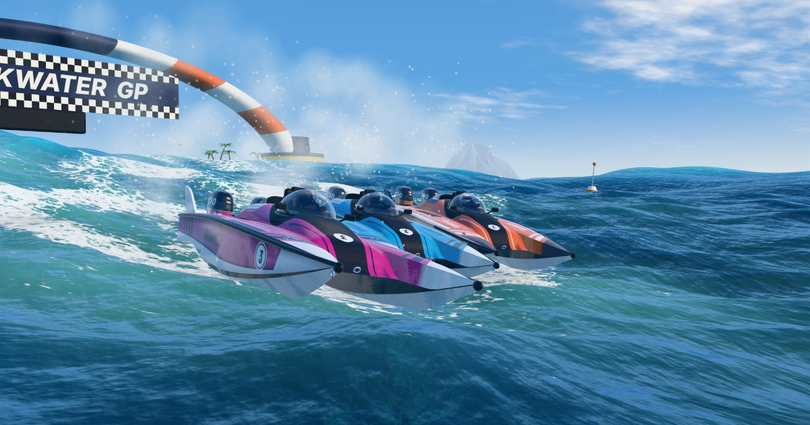 The pack a few seconds after the start | 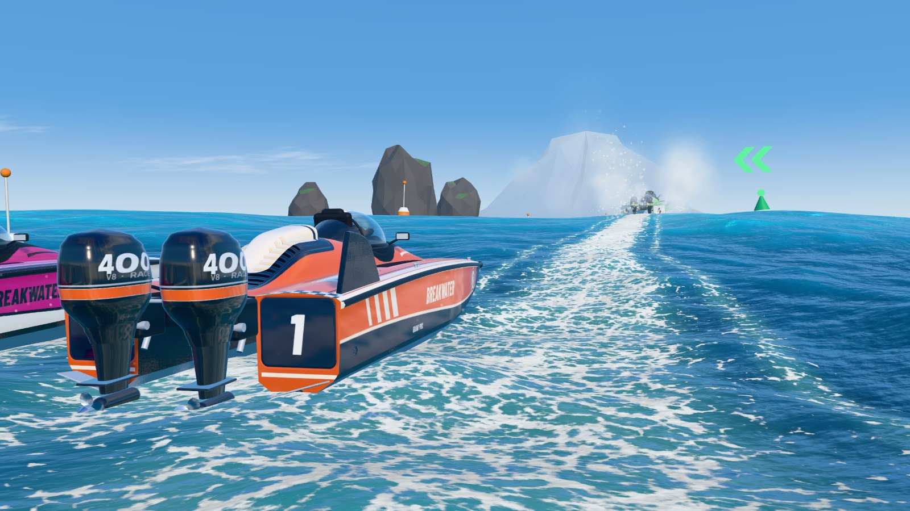 In the leader's wake |
| 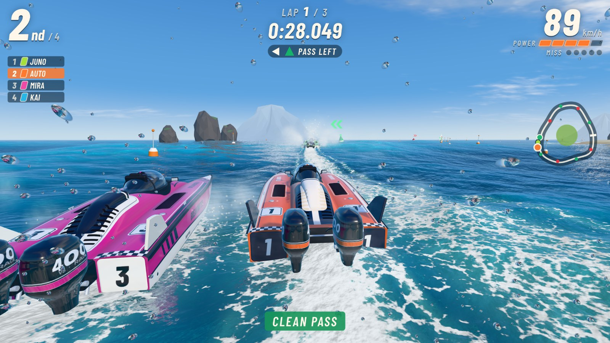 Racing: the view from the chase camera | 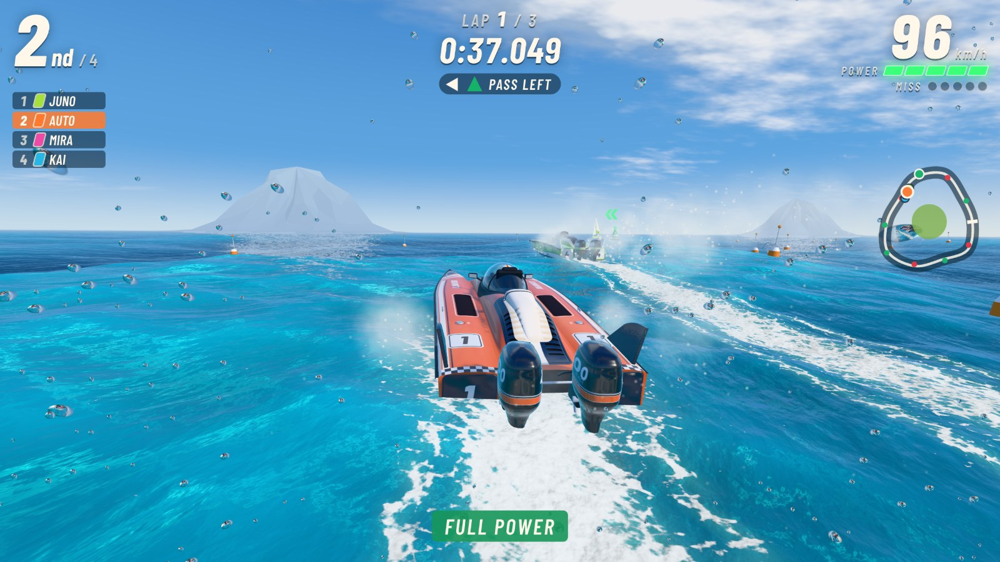 On the open-ocean side |
| 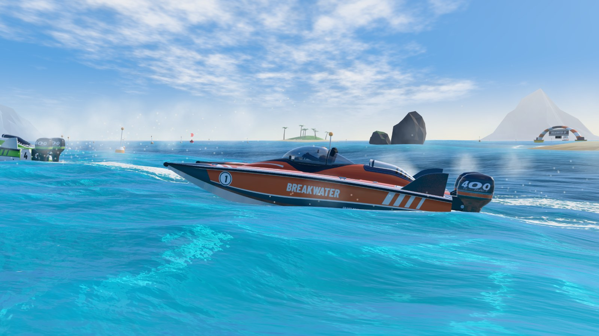 Spray plumes at full power | 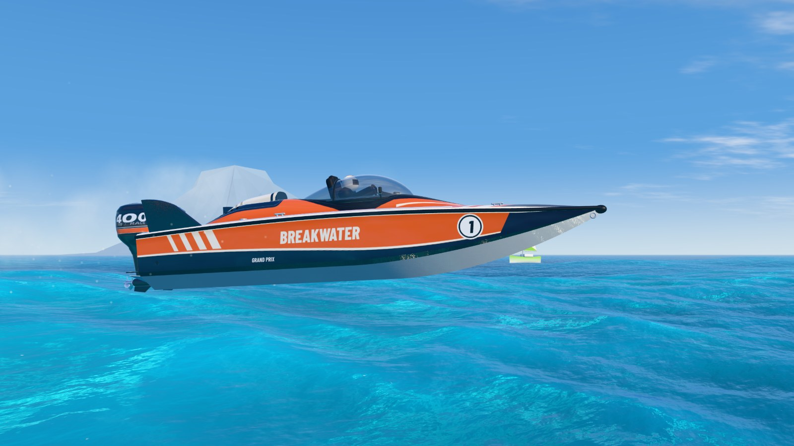 Off the top of a swell |
| 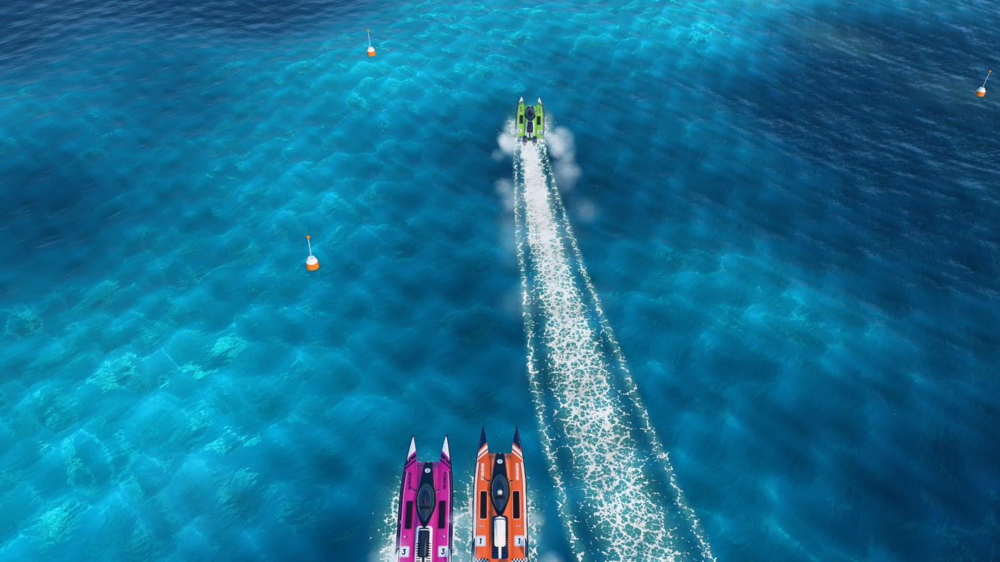 Wakes from above | 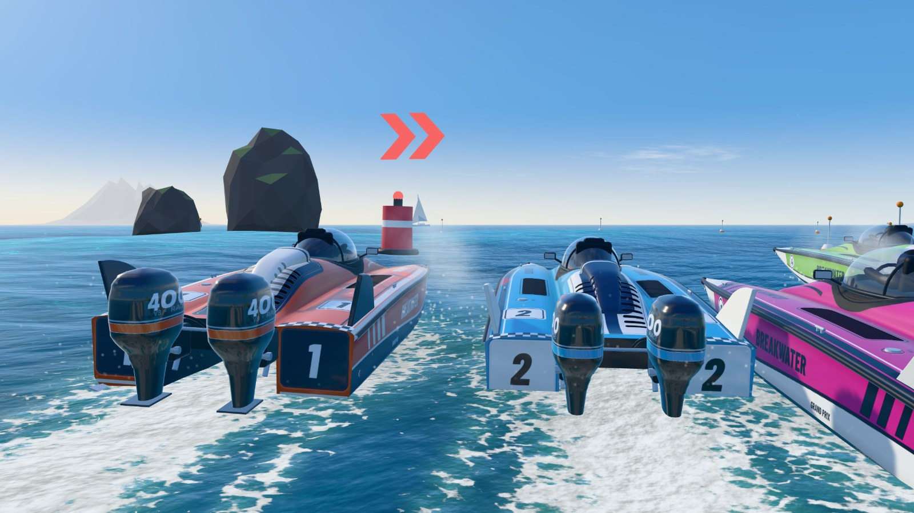 Calm water: rocks, marks and boats mirrored in it |
| 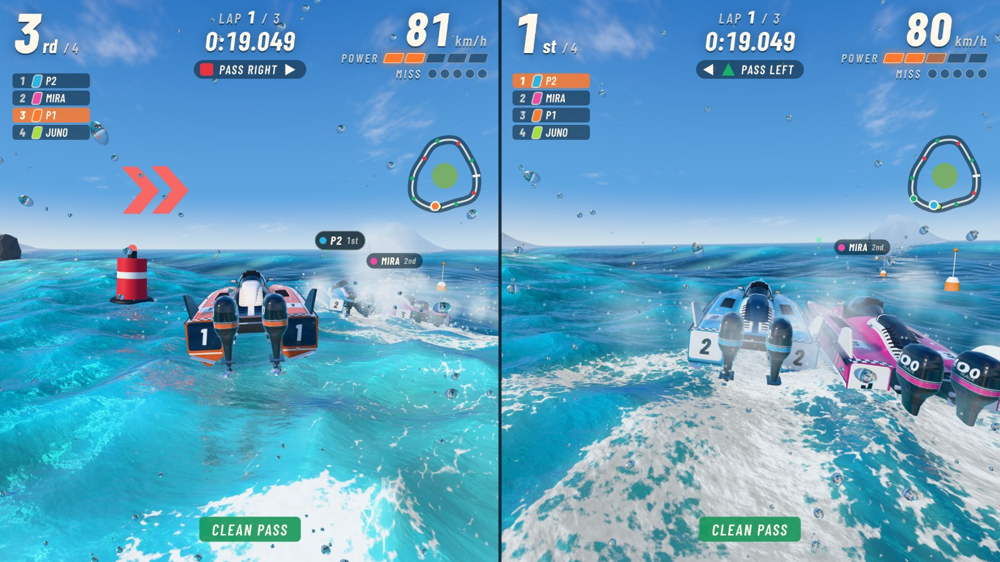 Two players on one keyboard | 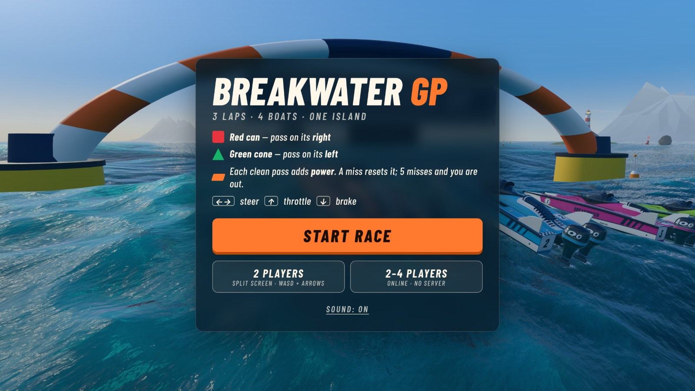 Title screen |
| 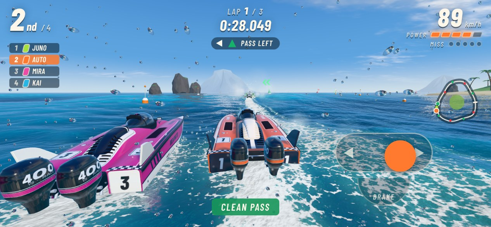 Phone, held sideways, one thumb on the glass | 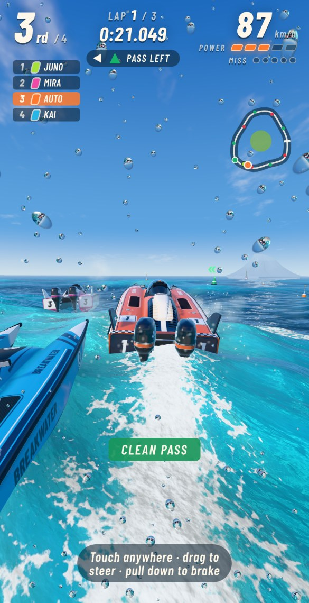 Phone, held upright |
| 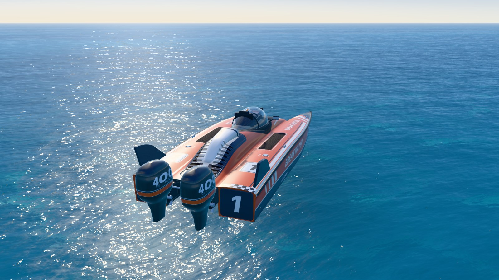 The boat from astern, into the sun | 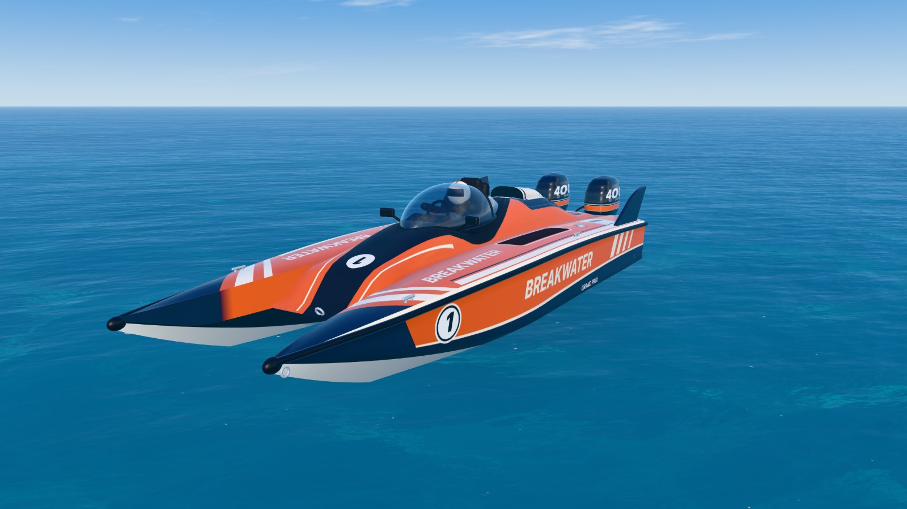 The boat from the port bow |
| 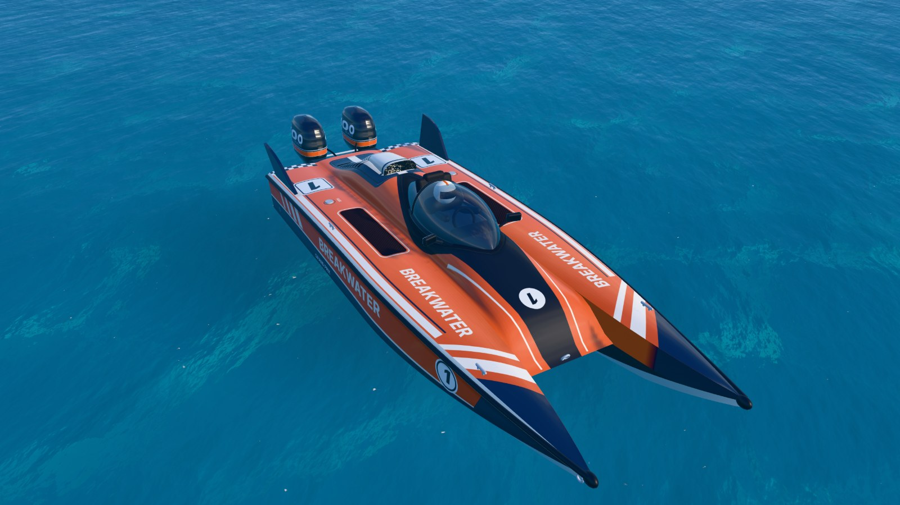 From above the starboard bow | 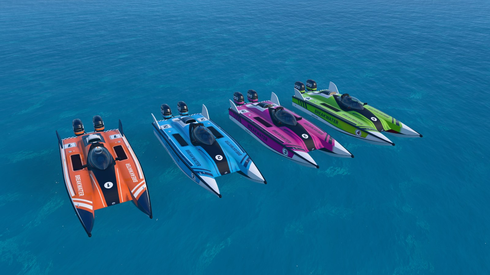 The four liveries |
| 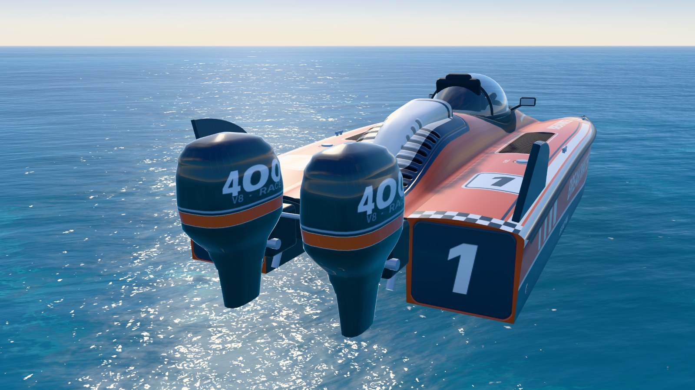 Outboards, transoms and the engine hatch | 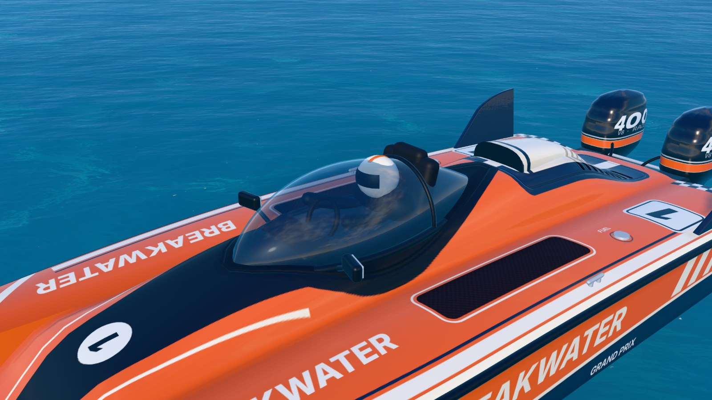 Canopy, driver and foredeck |
