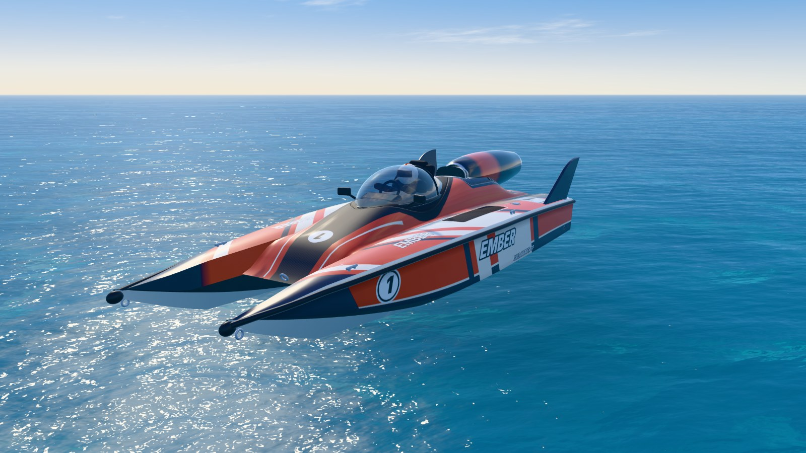
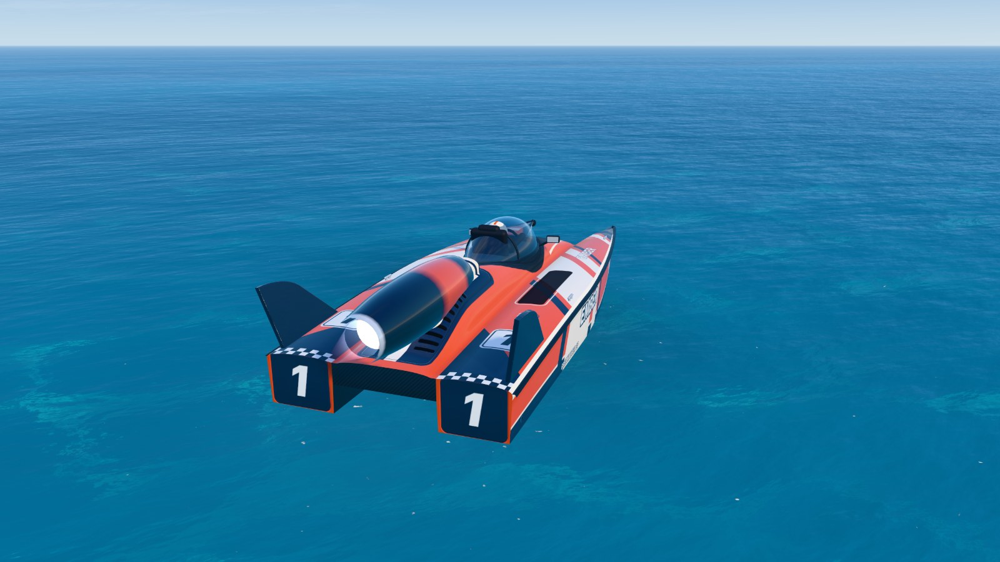
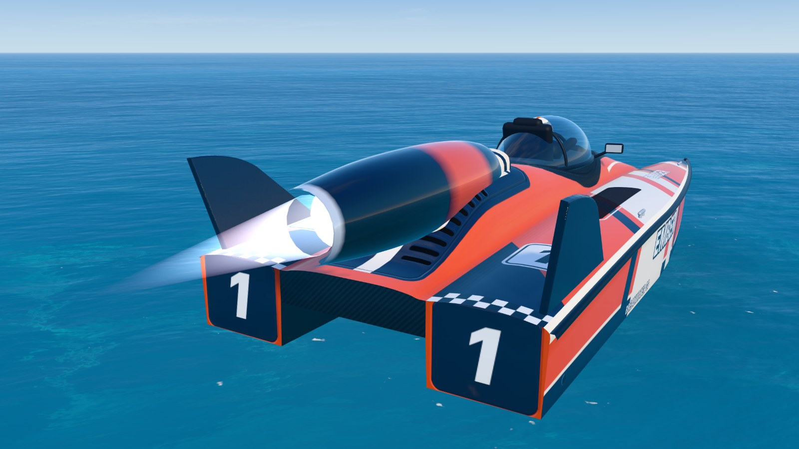
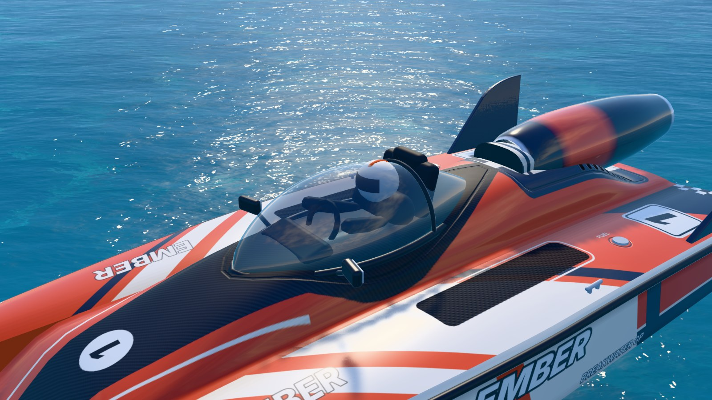
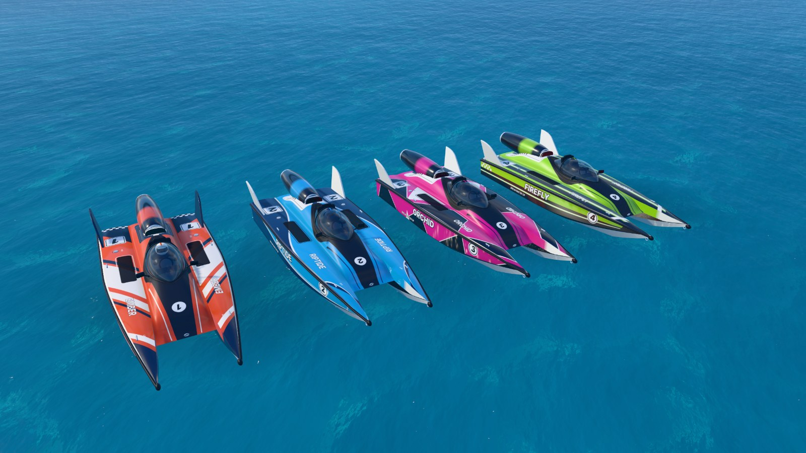
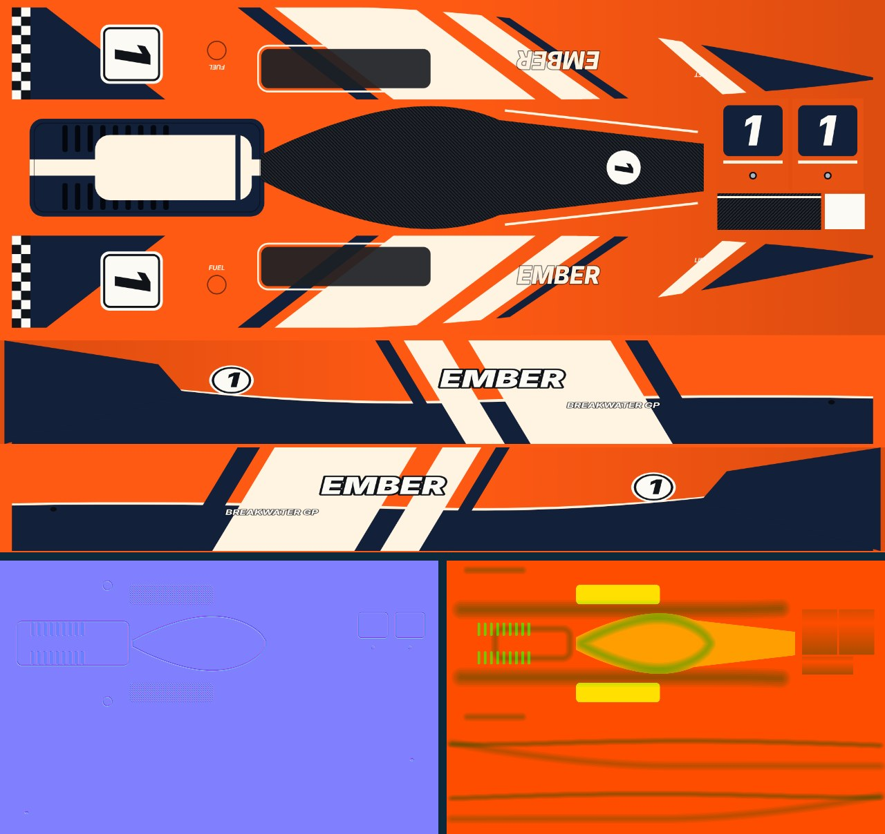

# The boat

One boat, four liveries, each to its own design. Everything about it is generated: the hull from a few
functions, the paint on a canvas, the glass and the gloss by shaders. This is
the reference for changing any of that. The ideas behind it are in
[techniques.md](techniques.md) (sections 6, 7 and 8).

| | |
| --- | --- |
|  |  |
|  |  |

## What it is

A tunnel-hull race catamaran from a few years ahead, 5.8 m long and 2.16 m
wide, driven by a turbine.

- Two slim hulls (**sponsons**) run the full length and end in bows that draw
  together like the points of a fork (1.2 m apart at the tips).
- A cambered **centre body** bridges them from the transom to a nose 1.2 m
  short of the bows. Under it, the **tunnel** is open from end to end.
- On the centre body: an **engine hatch** with louvres and an air scoop, then
  a glass **canopy** over the cockpit with the driver under it.
- Behind the canopy, on a swept pylon: the **turbine pod** that drives the
  boat, an intake at the front and a nozzle at the back. A disc inside the
  nozzle glows with the throttle and a cone of flame stands out behind it:
  short at cruise, long and white under boost. There are no outboards.
- Fins on the tails of the sponsons, rub rails, cleats, fuel caps, mirrors,
  trim tabs, bow eyes.

Axes: +Z bow, +Y up, +X port. The origin is on the waterline amidships, so
`y = 0` is where the sea is when the boat is at rest.

## Files

| file | holds |
| --- | --- |
| `assets/boat.js` | `createBoat(team, number)`: builds the meshes, assigns materials, returns the group |
| `assets/boat/lines.js` | the shape as numbers; cross-sections; the texture sheet's layout and the `uv…` functions |
| `assets/boat/hull.js` | geometry: hull, canopy, cockpit, fittings |
| `assets/boat/thruster.js` | the turbine pod, the glow in its nozzle, the flame and its material |
| `assets/boat/livery.js` | the paintwork and the shared detail maps, drawn on canvases |
| `assets/boat/materials.js` | paint, glass, cowl, trim, steel, cockpit materials |

`createBoat` returns a `THREE.Group` with `userData.setThrust(throttle, boost,
time)` (how hard the turbine burns: sets the glow and the flame) and
`userData.details`.

## The lines

`t` runs from 0 at the transom to 1 at the tips of the bows; `z = −2.7 + 5.8 t`.
`ramp(t, a, b)` is 0 below `a`, 1 above `b`, linear between.

| line | formula | meaning |
| --- | --- | --- |
| `outerAt` | `1.08 → 0.608` by `ramp(t, 0.4, 1)^1.55` | outer edge of a sponson (half beam) |
| `innerAt` | `0.46 → 0.592` by `ramp(t, 0.62, 1)^2.2` | its tunnel side |
| `keelAt` | `−0.24 + 0.64·ramp(t, 0.58, 1)^1.9` | bottom of the sponson |
| `chineAt` | `−0.04 + 0.5·ramp(t, 0.5, 1)^1.7` | where bottom meets side |
| `sheerAt` | `0.47 + 0.09·sin(π·min(t/0.92, 1)) − 0.05·ramp(t, 0.86, 1)` | top of the side |
| `crownAt` | stern deck 0.03, engine hatch +0.3, cockpit −0.07, foredeck −0.22 (smooth steps) | how far the centre line stands above the deck edge |
| `noseAt` | `smoothstep(0.7, 0.8, t)²` | the centre body rounding down into the tunnel |

Constants: tunnel roof at `y = 0.3`; the centre body ends at `t = 0.8`.

**A sponson's section** (`sponsonSection(t)`, port side, going round from the
tunnel): tunnel wall, inner bottom, keel, outer bottom, chine, spray rail,
side, gunwale, deck. Each named strip is skinned separately where there is a
hard edge between them; the gunwale and the deck are curves through three and
four points.

**The centre body's section** (`centreSection(t)`): seven points from the
port deck over the crown to the starboard deck, with the first step almost
level so that body and deck meet in a hollow.

**The canopy**: half an ellipsoid 1.75 m long, 0.68 m wide, 0.37 m high,
fuller toward the front (`canopyRadius`).

## The texture sheet

One sheet per boat, 2048 × 1280 (1024 × 640 on phones), laid out by
`lines.js`:

| chart | what | scale | texture coordinates from |
| --- | --- | --- | --- |
| top | the boat seen from above: stern left, port side up | 343.6 px/m | `uvTop` |
| port side | seen from outside, bow on the left | 343.6 px/m along, 230.8 px/m up | `uvPort` |
| starboard side | seen from outside, bow on the right | the same | `uvStbd` |
| three transoms | seen from astern; they sit in the top chart's empty space between the bows | 250 px/m | `uvTransom(±1 or 0)` |
| blank | plain white, for everything coloured by its vertices | | `UV_BLANK` |

The same layout is used three times:

1. **Livery** (colour, per boat): `paintLivery(team, number)`.
2. **Normal map** (shared): painted as heights, converted by a Sobel pass.
3. **Occlusion / roughness / metalness** in red / green / blue (shared).

### Painting

`livery.js` gives three drawing spaces. Inside each, coordinates are metres:

- `inTop(ctx, draw)`: `(z, x)`, bow to the right, port up.
- `inSide(ctx, port, draw)`: `(z, y)` as seen from outside that side.
- `inTransom(ctx, chart, draw)`: pixels from the chart's top-left corner.

Helpers: `edge(lineAt, side, a, b, inset)` gives points along a hull line (so
stripes can follow it), `deckBand(side, cutA, cutB)` the part of a sponson
deck between two slanting cuts, `label(ctx, text, a, b, { size, dir })`
lettering of a given height in metres that reads the right way round on
whichever chart it is on.

A team is `{ hull, accent, mark, pattern }` in `assets/palette.js`: two
colours, the name painted on its flanks, and which design it is painted to. A
third colour is derived (`teamColors`): deep navy if the accent is light,
off-white if it is dark.

**The four designs** (`PATTERNS` in `livery.js`). Each paints the decks
(`top`, once per side, in the plan view) and the flanks (`side`):

| design | team | what it is |
| --- | --- | --- |
| `slash` | EMBER (orange, cream) | broad bands slashed across the decks and carried down the flanks, raked back; a dark stern quarter; chequers on the tail |
| `wave` | RIPTIDE (blue, navy) | one long sweep of dark water curling along each hull and a smaller curl over the bows, edged in white; on the flanks a wave that is tall at the stern and runs out at the bow |
| `shard` | ORCHID (magenta, black) | black shards with white edges, as if the paint had been cut with a knife |
| `stripe` | FIREFLY (lime, charcoal) | twin racing stripes from stern to stem with a pinstripe between; a dark nose; the stripes break up into squares at the stern |

**What every boat has**, painted over the design: hull colour deepening
toward the bows; step pads; number plates on the stern decks (read from
astern); the team's name along each foredeck and, large, on each flank, with
the series name under it; a roundel on the nose and on each flank; an engine
hatch panel with louvres; a panel of bare carbon weave round the canopy so
the glass does not glare (a 2/2 twill drawn as an 8 px tile); numbered panels
on the transoms.

## Materials

All from `createBoatMaterials` in `materials.js`. Every one except the cockpit
is a `MeshStandardMaterial` with the mirror coat on top
(`withLiveReflections`: strength, face-on weight, glancing weight, blur).

| material | on | base | coat |
| --- | --- | --- | --- |
| paint | hull | livery map × vertex colour, normal map, occlusion + roughness map | 1.2, 0.06, 0.44, 0.5 |
| glass | canopy | dark tint, 46 % opaque, roughness 0.06 | 1.55, 0.09, 1.0, 0 |
| pod | turbine pod | vertex colour (carbon, a band of the team's colour, bright lips), roughness 0.2, metalness 0.3 | 1.3, 0.08, 0.9, 0.15 |
| glow | disc in the nozzle | unlit, the team's fire colour times the throttle | none |
| flame | cone behind the nozzle | light added to the picture, hottest at the nozzle | none |
| trim | rails, fittings, brackets | vertex colour, roughness 0.38, metalness 0.25 | 0.8, 0.05, 0.6, 1.4 |
| cockpit | seat, driver, wheel | vertex colour, roughness 0.6 | none |

Everything casts and receives the sun's shadow, except: the glass does
neither, the cockpit receives but does not cast, the glow and the flame do
neither.

## Budget

| part | triangles | draw calls |
| --- | --- | --- |
| hull | 7 900 | 1 |
| trim | 6 000 | 1 |
| turbine pod | 1 500 | 1 |
| glow, flame | 250 | 2 |
| canopy | 1 300 | 1 |
| cockpit | 1 150 | 1 |
| **one boat** | **about 18 000** | **7** |

Textures per boat: one livery sheet. Shared by all boats: the normal sheet,
the occlusion/roughness sheet, the engine label (512 × 256).

## How to…

**Add or change a team.** Edit `TEAMS` in `assets/palette.js`: `hull`,
`accent`, `mark` (the name on the flanks), `pattern` (one of the four
designs) and `css` for the HUD. The livery, the fins, the engine stripe and
the driver's helmet follow.

**Add a design.** Add an entry to `PATTERNS` in `livery.js` with a
`top(ctx, side, colours)` and a `side(ctx, colours)`. Use `deckBand`, `edge`
and `sidePoint` so that its shapes follow the hull's lines.

**Change the livery.** Edit `paintLivery` in `livery.js`. Draw in metres
inside `inTop` / `inSide` / `inTransom`. If you move something that also has
a seam, a rough patch or a fitting (a step pad, the filler cap, the engine
hatch), move the shared constant at the top of the file (`PAD`, `FILLER`,
`HATCH`, …), which the detail maps and `hull.js` read too. Then look at the
result: `viewer.html?asset=craft&flat&sea=0.05`, or `node tools/screenshots.cjs
--only livery-sheet,boat-front,boat-rear`.

**Change the hull's shape.** Edit the line functions in `lines.js`. The
geometry, the paint that follows the edges, and the texture coordinates all
derive from them. If the boat's length, beam or the position of its transom
change, update `HULL` in `game/config.js` too: that is what the physics, the
collisions, the wake and the spray use.

**Add a fitting.** Add a `part(...)` to `buildTrimGeometry` in `hull.js`. Use
`bodyTopAt(t, x)`, `sheerAt(t)` and friends to stand it on the surface.

**Change the gloss.** The four numbers after each material in `materials.js`.
More `edge` on the paint gives a more mirror-like deck from astern and less of
the livery's colour.

## Known compromises

- Recesses are painted and normal-mapped, not modelled.
- Paint on the steep flanks of the centre body is stretched by the top-down
  projection: keep lettering off them.
- The glass is one layer: no reflections of the inside, no refraction.
- The flame is a cone of added light, not a volume: seen exactly end-on it
  is a bright ring.
