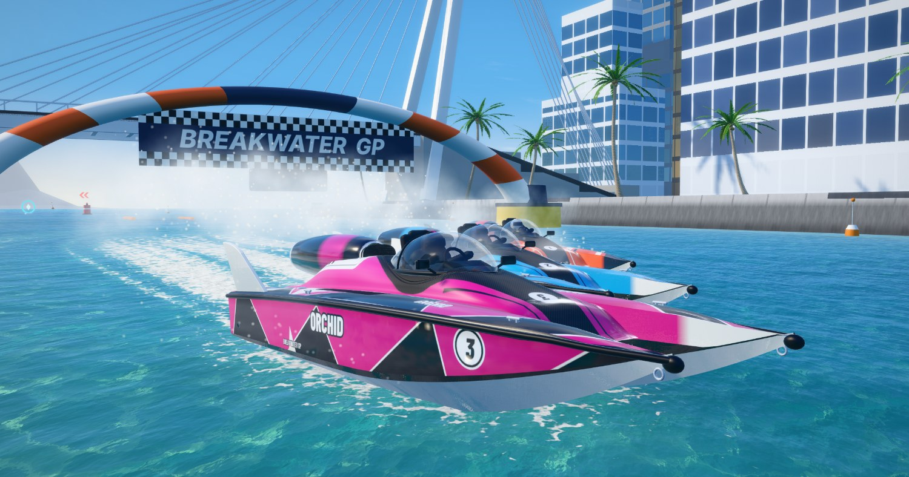

# Design

What Breakwater GP is meant to be. For what the build actually does, number
by number, see [spec.md](spec.md).

## The game in one paragraph

Four turbine-driven race boats, three laps up a city river and round a green
island, on a sea that is really there. The swell lifts the hulls, throws them
into the air and drops them again, and the same waves you see are the ones
the boat rides. Slalom marks along the course are the one rule: pass each on
its proper side and the turbine gives more; miss, and it gives less. Boost
pads, nitro cells and ramps lie on the water for whoever can reach them
without breaking that rule. It plays in a browser, with a keyboard or with
one thumb, alone, with a friend on the same keyboard, or with up to three
friends on their own devices and no server in between.

It is an original game. Other games were looked at for what "good" looks like
(how water reads, how close a camera should sit, how spray hangs), never for
names, characters, courses or art.

## What it is built round

1. **The sea is the other player.** A race on flat water would be a time
   trial with scenery. Here the surface is the difficulty and the fun: crests
   launch you, troughs hide the next mark, the river is nearly flat and
   the open side is not. That only works if the water is honest, so one set of
   waves drives both the picture and the physics.
2. **One rule, visible from a distance.** Red can: pass to its right. Green
   cone: pass to its left. Everything else (power, misses, being put back on
   course) follows from that, and each consequence is shown the moment it
   happens.
3. **The boat fills the frame.** The camera sits low and close, so you see the
   hull working: the turbine's nozzle glowing with the throttle, the tails
   clearing the water, the paint mirroring the wake. A boat that small in the frame would be a marker
   on a map.
4. **Playable wherever you are.** Arrow keys; or one thumb anywhere on a
   phone, with throttle automatic. Split screen on one keyboard. Online
   between browsers with nothing to install and no account.
5. **Made of code.** No model, texture or sound files. The hull is swept from
   equations, the livery is painted on a canvas, the engines' sound is three
   oscillators. This keeps the whole thing small, and it means every asset can
   be changed by changing a number.

## A race

- **Grid.** Four boats abreast, fourteen metres short of the arch, idling on
  the swell.
- **Countdown.** Three beeps and a higher one. The lights on the arch go out.
- **Three laps** of the course, about a minute each. Nine
  slalom marks per lap alternate sides, so the fast line swings from one side
  of the course to the other and crosses the swell at changing angles.
- **Flag.** The first boat home wins; the rest are classified as they finish.
  Bots that are still out are classified where they are after a short wait.
- **Results**, with lap times, and "race again".

## Rules

- **Marks.** A red can is left to port (you pass on its right). A green cone
  is left to starboard (you pass on its left). The colours and shapes follow
  real lateral marks, and a chevron over each one points the way for anybody
  who does not know them.
- **Power.** Each clean pass adds one level, up to five; each level adds top
  speed. A missed mark puts power back to zero. Power is the whole economy of
  the game: a clean lap is a fast lap.
- **Misses.** Five and you are out. Bots are never put out; they just lose
  their power.
- **The floats.** Orange floats line both edges of the course. Outside them
  for five seconds and you are put back in the middle, without power.
- **Contact.** Boats shove each other and bounce off marks and moored boats.
  Nothing breaks.

## How it should feel

- **The boat is heavy and the sea is in charge.** You steer and choose when to
  lift; you do not fly the boat. In the air there is no thrust and no
  steering, and a hard landing costs speed, so reading the swell matters more
  than reflexes.
- **Slides are part of turning.** Grip is finite on purpose. A gentle helm
  carves; a hard one makes the hulls let go and the boat drifts, nose inside
  the turn, throwing water off the outside bow, until you ease the helm and
  it straightens. Braking in a turn digs the hulls in for a tight powerslide.
  The camera follows the direction of travel rather than the bow, so you see
  the slide.
- **The boat lies on the water.** Nothing sets its attitude: four points
  under the hulls are pushed up by the water they are in, and the boat
  pitches and rolls as those forces balance. It rides a swell, lands tails
  first, and comes down on one hull when it took off crooked.
- **Fast is smooth.** The quickest way through the slalom is wide and early,
  not sharp and late.
- **Nothing is hidden.** Position, lap, time, power, misses, speed, the next
  mark's side, and a map are always on screen. A toast says what just
  happened ("Clean pass", "Power lost · 4 misses left").

## The camera

Behind and a little above the stern, 5 to 6 metres from the middle of the
boat, looking slightly down: the transom sits near the bottom of the frame
and the horizon above the middle, so the water ahead takes up most of the
picture. It follows height lazily, so the boat visibly rises and falls on the
swell and floats up the frame in a jump; it follows the direction of travel
more than the heading, so slides read as slides; it swings to the outside of
a turn and leans with it, so the boat is seen from its flank as it carves;
the lens widens with speed; and under boost the boat pulls away from it for a
moment while the picture stretches and trembles. Before the start and after
the flag it orbits the boat instead.

## The boats

Tunnel-hull catamarans from a few years ahead: a closed canopy, bows that
draw together like the points of a fork, and a turbine in a pod behind the
driver instead of outboards. That shape was chosen for what it shows from
behind: two hulls and an open tunnel give the spray and the wake something to
do, a wide stance reads as stable, and the turbine's nozzle, glowing with the
throttle and throwing a flame under boost, sits right in front of the camera
and says how hard the boat is working. All four boats are the same boat, each
painted to a design of its own (slashed bands, a wave, shards, racing
stripes) so that they can be told apart at a glance from any side; the race
is decided by driving. See [boat.md](boat.md).

## The course

Two islands and the river between them; one loop of about 1.5 km. The race
starts in the river, in the middle of a city: towers of glass on the east
bank, a waterfront town on the west, palms along both quays, three bridges
overhead. There the water is nearly flat and the walls are close: it is the
fast, tight part, with boost pads to line up for. At the river's mouth the
course swings out round the green island by the open sea, where the swell
comes in, the boat is in the air a good part of the time, and ramps and
nitro cells reward a driver who can hold a line across the waves. Then back
in at the southern mouth, under the first bridge, to the line.

The green island is the thing you look at when you are not looking at the
water: a forested hill, grass that the wind runs across in bright waves, a
beach of rippled sand going dark and glossy where the sea reaches it, and
groves of coconut palms laying long shadows.

**Going faster.** Three things on the water give boost, all used the moment
they are touched: *pads* (a short push), *nitro cells* (a long one; a cell
you have taken is back a few seconds later) and *ramps* (a push and a jump).
None of it is stored or aimed: the skill is in the line that strings them
together without missing a mark.

## Opponents

Three bots drive a racing line through the marks, each with a preferred side
of it, a wobble and a slightly different top speed. They avoid a stern in
front of them, never go round a mark the wrong way, and are quietly held
within reach of the human (a few percent of speed either way), so a mistake
does not end the race and a clean run still wins it.

## Multiplayer

- **Split screen**: two views side by side, each with its own readouts,
  lens, and half of the stereo field for its sound.
- **Online**: two to four players. No server: the host passes each friend an
  invite link by chat and gets a reply code back. Every player simulates their
  own boat on their own device, so the controls never wait for the network;
  everybody shares one clock, so the waves are in the same place for all.

## The look and the sound

A bright, hazy afternoon with the sun fairly low over the open ocean, so wave
tops are lit from behind and glow turquoise. Colour is saved for the things
that matter: the four liveries, the red and green marks, the orange floats.
Reflections do the rest of the work of making the boats sit in the scene: the
paint and glass mirror what is really around them, and the water mirrors the
boats back, and in the river the towers and the bridges too. Spray hangs in
plumes behind a boat at speed. Sit in another boat's plume and it rains on
the glass, the way it does on a windscreen: droplets land and sit, swell,
let go and run down leaving wet tracks that dry; the way to clear it is to
get out of the spray. The picture is finished like a photograph: a glow round the sun
on the water, crisp detail, slightly darker corners.

Sound is engines (deeper for the bigger hulls), water rushing past, and a
handful of signals: count, go, clean pass, miss, lap, flag, and the thump of
a landing.

## Deliberately not here

- Weapons, pickups, boosts: the sea is enough.
- Damage and repairs.
- A career, unlocks, currencies, accounts.
- More than one course (one good one first; see [ideas.md](ideas.md)).
- A game server.
