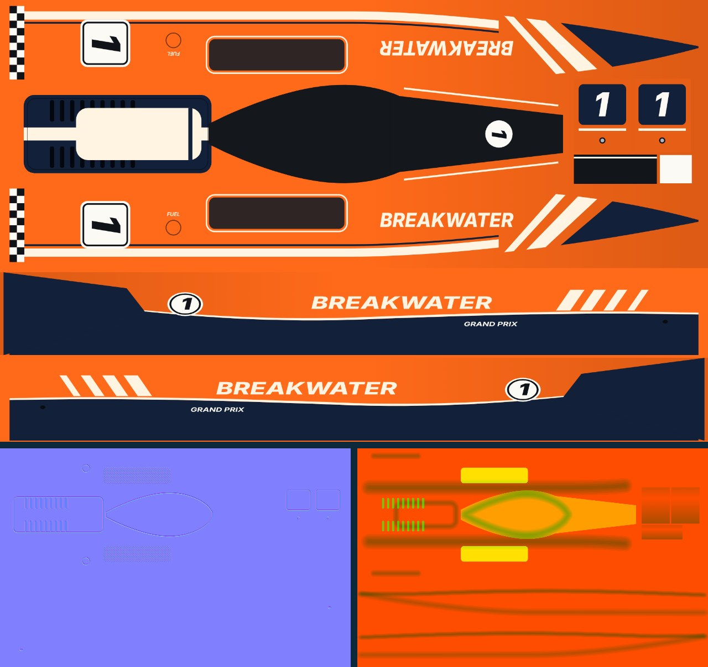
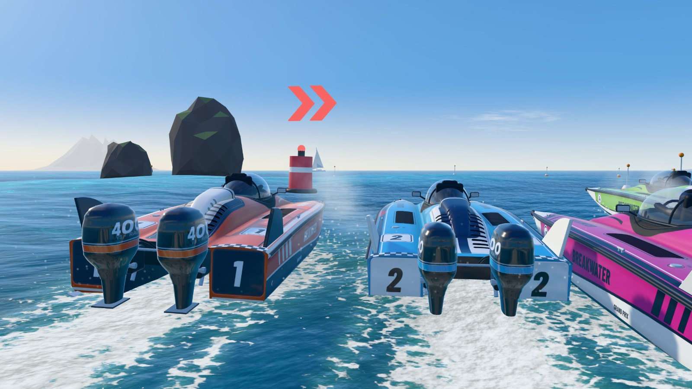

# Techniques

The parts of Breakwater GP that are not obvious from reading the code once:
what problem each solves, the trick, where it lives, what it cannot do, and
where to take it next. For exact numbers see [spec.md](spec.md).

- [1. One sea for the eyes and for the hull](#1-one-sea-for-the-eyes-and-for-the-hull)
- [2. An ocean that reaches the horizon](#2-an-ocean-that-reaches-the-horizon)
- [3. Shading the water](#3-shading-the-water)
- [4. Foam in the water, not on it](#4-foam-in-the-water-not-on-it)
- [5. Jumps nobody scripted](#5-jumps-nobody-scripted)
- [6. A hull from equations](#6-a-hull-from-equations)
- [7. Paint drawn in metres](#7-paint-drawn-in-metres)
- [8. A mirror coat over ordinary paint](#8-a-mirror-coat-over-ordinary-paint)
- [9. The water as a mirror](#9-the-water-as-a-mirror)
- [10. One patch of shadow](#10-one-patch-of-shadow)
- [11. Spray in two sizes](#11-spray-in-two-sizes)
- [12. Water on the lens](#12-water-on-the-lens)
- [13. A camera that does not follow](#13-a-camera-that-does-not-follow)
- [14. Sound from nothing, and how to test it](#14-sound-from-nothing-and-how-to-test-it)
- [15. Online without a server](#15-online-without-a-server)
- [16. Tests and pictures that do not depend on the clock](#16-tests-and-pictures-that-do-not-depend-on-the-clock)
- [17. Giving ground gracefully](#17-giving-ground-gracefully)
- [18. Smaller things worth knowing](#18-smaller-things-worth-knowing)

---

## 1. One sea for the eyes and for the hull

**Problem.** If the water you see and the water the physics uses differ, the
boat floats above troughs and ploughs through crests, and the player cannot
read the sea.

**Trick.** The sea is defined once, as a table of trochoidal waves and an
amplitude field (`engine/waves.js`). That module emits the same maths twice:
as GLSL (`WAVE_GLSL`, used by the ocean's vertex and fragment shaders) and as
JavaScript (`sampleSurface`, used by buoyancy, floating props, the camera
floor, and spray hitting the water). The wave table is uploaded as uniforms;
nothing is duplicated by hand.

- Trochoidal waves move water sideways as well as up. To ask "how high is the
  water *at* (x, z)?" the CPU first has to find which bit of water has been
  pushed there: three fixed-point iterations, which is plenty at these
  steepnesses.
- A second tier of short, steep chop (under 8 cm) is drawn by the GPU only. It
  makes the surface look sharp and confused, and leaving it out of the physics
  cannot be felt.
- The amplitude field (calm in the island's lee and near shores) is evaluated
  by the same function on both sides.

**Limits.** The sum is evaluated per sample, so cost grows with the number of
waves times the number of samples: five samples per boat, 120 times a second,
six waves is nothing; a hundred waves would not be. Waves do not refract round
the island or break on the beach.

**Next.** A wave that steepens and breaks on the shallow side; wind gusts that
modulate the chop; a course-specific wave table (see [ideas.md](ideas.md)).

## 2. An ocean that reaches the horizon

**Problem.** A flat grid fine enough near the boat is far too many triangles
by the horizon.

**Trick.** A radial grid (`createRadialGridGeometry` in `assets/water.js`):
rings whose spacing grows geometrically with radius, so quads stay roughly
square in world space, dense under the boat and enormous far away. The mesh
does not move; a `uCenter` uniform slides the pattern so that its dense middle
sits under the view's boat, and the waves are evaluated in world space, so
nothing swims.

A wave is only displaced where the mesh has about five vertices per
wavelength (`setWaveMeshDensity`). Further out it fades from the geometry and
lives on in the per-pixel normals, which are computed analytically from the
same wave table rather than from the mesh.

**Limits.** In split screen the mesh is re-centred per view, which is why each
view is drawn in its own pass. The centre fan has many thin triangles.

**Next.** Tessellate by screen-space error instead of by distance from the
boat; a projected grid would give constant density on screen.

## 3. Shading the water

All in the fragment shader of `assets/water.js`. No screen-space effects, no
depth buffer read.

- **Light through the wave.** Water glows where there is little of it between
  the sun and your eye: the top of a wave, a crest that is bunching up, a
  steep face turned toward you, and most of all when you look toward the sun.
  Each of those is a cheap term from the wave height, the Jacobian of the
  displacement (how much the surface is being squeezed) and two dot products;
  together they read as translucency.
- **Caustics made the way they are made** (`makeCausticTexture` in
  `assets/textures.js`). A grid of rays is bent by the slopes of a periodic
  ripple field and splatted where it lands; where neighbouring rays cross,
  light piles up into the familiar net. Built once on the CPU. In the shader
  two copies slide over each other and are *multiplied*, so lines flare where
  they meet and vanish where they part. The same texture lights the inside of
  the waves and lies sharp on the sand in the shallows.
- **Foam that lingers.** Foam belongs where a crest broke a moment ago, not
  where the crest is now. Rather than simulate it, the shader asks the wave
  function how hard the swell was bunching up here *now and 0.9, 1.9 and 3.1
  seconds ago* (the waves are a closed formula, so the past is free) and keeps
  the strongest, fading with age. The result trails behind the moving crest.
  A noise pattern cut by that mask gives lacy threads over a veil of aerated
  water.
- **Glitter at constant size.** Sun sparkle comes from a normal-map lookup
  whose scale is chosen per pixel from `log2(distance)`, blended between the
  two nearest octaves, so facets stay a few pixels across from the bow to the
  horizon instead of turning to noise far away.
- **Sky reflection without a texture.** The sky is a formula
  (`skyGradient`), so the water evaluates it in the reflected direction.

**Limits.** No refraction of what is under the water; depth near shores is
faked from the distance to the island's shore circle.

**Next.** Cloud reflections (the cloud layer is a formula too); foam on the
beach that runs up and back; underwater caustics on the hulls.

## 4. Foam in the water, not on it

**Problem.** Wakes drawn as geometry float above the swell, z-fight, and
cannot blend with the sea's own foam.

**Trick.** A small render target, the *wake field* (`WakeField` in
`game/effects.js`), is redrawn every frame from straight above, centred on the
view's boat. The ocean shader samples it like any other texture, so foam sits
in the surface, bends over the swell, and is lit like the rest of the water.
Three channels:

- **Red, churned water.** Each boat's trail is a ribbon of points recorded in
  *undisplaced* sea coordinates (so the foam drifts with the water rather than
  sliding over it), widening with age. Plus a soft stamp round each hull and
  expanding rings where a hull came down.
- **Green, shadow.** A soft blob under each hull, thrown away from the sun,
  sliding out and fading as the boat leaves the water. This is the boats'
  shadow on the sea; the real shadow map (section 10) only covers the boats
  themselves.
- **Blue, freshness.** 1 at the stern, falling to 0. In the shader fresh churn
  is solid white; as it ages the same bubble pattern is cut by a rising
  threshold and opens into lace, then flecks. The two edges of the ribbon
  outlast its middle, as real wakes do.

Blending is MAX, so overlapping wakes do not add up to a white sheet.
Churned water also roughens the normals, so it stops mirroring the sky.

**Limits.** One field per view, 176 m across: wakes further away are not
drawn. Trails are straight ribbons between points 1.9 m apart.

**Next.** Kelvin wake arms; displacement (a real bow wave) written into a
fourth channel and added to the vertex shader.

## 5. Jumps nobody scripted

**Problem.** Scripted jumps feel the same every time, and a spring that pulls
the hull down to the water as well as up makes boats stick to the surface.

**Trick.** Buoyancy is a *one-sided* spring (`game/Craft.js`). Water pushes
up; only gravity pulls down. Run a hull at a crest fast enough and it simply
leaves, flies, and comes down, with no jump code anywhere. Around it:

- "Grip" (how deep the hull sits) scales thrust, drag, steering and how hard
  the hull's attitude follows the sea, so everything fades out together as
  the boat leaves the water.
- Landing uses velocity-squared drag on a hull driving down into the water,
  which stops a hard landing near the surface instead of bouncing it back out.
- The hull's attitude is fitted to samples a hull length apart, which filters
  out waves shorter than the boat for free.
- Physics is stepped at a fixed 120 Hz and drawn interpolated, so handling
  (and bots, and jumps) are identical at any frame rate.

**Limits.** The hull is a point mass with an attitude that follows the sea; it
has no moment of inertia, cannot trip over a chine, cannot stuff its bows.

**Next.** Per-sponson buoyancy (two floats, real roll dynamics); air under the
tunnel lifting the bows at speed, with a blow-over if you overdo it.

## 6. A hull from equations

**Problem.** No model files, and a shape good enough to be seen up close under
glossy paint.

**Trick.** Each body is a cross-section swept from stern to bow
(`assets/boat/lines.js`, `hull.js`). The lines of the hull (beam, keel, chine,
sheer, tunnel) are small functions of `t`, the fraction of the length; the
section at any `t` is a handful of points derived from them.

- **Hard edges are separate strips; smooth skins are one mesh.** Where a real
  hull has an edge (keel, chine, spray rail, gunwale) the section is split and
  each strip is lofted on its own, so normals break there. Where it is rounded
  (decks, the centre body, the canopy, the engine cowls) it is one skin with
  smooth normals, because glossy paint shows every crease.
- **Curves through few points.** Deck camber and the centre body's shoulders
  are Catmull–Rom curves through three to seven control points per section,
  resampled to as many columns as the highlight needs.
- **A hollow, not a crease.** The centre body leaves the deck level and only
  then climbs, so the two meet in a fillet.
- Small parts (rails, cleats, brackets) are primitives baked into one
  geometry per material by `part()` and `merge()`.

**Limits.** No booleans: a recess (louvres, hatches) is painted and
normal-mapped, not cut.

**Next.** See [boat.md](boat.md) for how to change the shape.

## 7. Paint drawn in metres

**Problem.** Liveries need stripes, numbers and lettering that follow the
hull, on a model with no UV unwrap and no image files.

**Trick.** The texture sheet is laid out by *planar projection*, which for a
boat is nearly distortion-free: decks are seen from above, sides from the
side, transoms from astern (`assets/boat/lines.js` holds the layout, and
`uvTop` / `uvPort` / `uvStbd` / `uvTransom` turn a vertex into a texture
coordinate). The sheet is a canvas, painted at start-up by
`assets/boat/livery.js`.

- **The painter works in the boat's coordinates.** `inTop`, `inSide` and
  `inTransom` set the canvas transform so that drawing commands take metres.
  A stripe along the deck edge is drawn *from the same function that shapes
  the deck edge*, so paint and geometry cannot disagree.
- **Lettering the right way round.** The charts are mirror images of each
  other (the port side is seen with the bow on the left). `label()` reads the
  current transform's handedness and flips accordingly, so text always comes
  out readable from the side it is on.
- **The waste is used.** The open water between the two bows is empty in the
  top view; the three transoms and a patch of plain white live there.
- **Plain parts look at the white patch.** The bottom, the tunnel and small
  parts are coloured by their vertices; their texture coordinates all point at
  the white patch, so one material and one draw call cover the whole hull.
- **Detail without geometry.** A second canvas is painted as *heights* (mid
  grey flat, dark cut in, light proud): seams, louvres, the grit of the step
  pads. A Sobel pass turns it into a normal map. A third holds occlusion (red:
  soft dark strokes along the hollows, under the rub rail, round the canopy),
  roughness (green: the step pads and the anti-glare panel are dull) and
  metalness (blue). These two are shared by every boat.
- **Fonts arrive late.** The lettering uses the page's display font; if it has
  not loaded when the paint goes on, the sheet is repainted when it lands.

**Limits.** Steep surfaces in the top view (the flanks of the centre body)
stretch the paint. One sheet per boat is 2048 × 1280 (a quarter of that on
phones).

**Next.** Per-player liveries chosen in the lobby (the painter already takes
any two colours); sponsor-style panels from a list; dirt and salt streaks as
another layer.

## 8. A mirror coat over ordinary paint

**Problem.** Reflections sell a glossy hull. The standard environment map is
static and shows only sky: nothing moves across the paint.

**Trick.** Two layers.

1. **The live map** (`ReflectionProbe` in `engine/ReflectionProbe.js`): a
   small cube map of the real scene, redrawn from the first view's boat *one
   face per frame*, so it costs one small extra pass and is never more than
   six frames old. While a face is being drawn the materials are pointed at a
   plain stand-in cube, because a texture cannot be read while it is being
   written. The sea in this picture is a stand-in mesh with a twentieth of the
   triangles; the boat the probe sits in, the spray and the mist are left out.
2. **The coat** (`withLiveReflections`): a patch applied to any built-in lit
   material through `onBeforeCompile`. Just before the final colour is
   written it adds a lookup into the live map along the reflected view
   direction, weighted by a Fresnel term. Underneath, the material is lit as
   usual (sun, static sky map, shadows).

Details that matter:

- **The edge is capped.** A true mirror at a glancing angle would turn a deck
  seen from astern into pure sky. `edge` limits the weight (0.44 for paint,
  1.0 for glass), which keeps the livery's colour.
- **It follows the surface.** The coat fades out where the roughness map says
  the surface is dull, blurs with roughness (by sampling a lower mip), and is
  dimmed by the occlusion map, so a step pad mirrors nothing and a hollow
  mirrors little.
- **Energy is roughly conserved.** What the coat reflects is taken off the
  paint underneath.
- **Glass.** On a transparent material the same patch raises the alpha by the
  Fresnel weight and divides the colour to compensate: what shows through is
  dimmed by the tint, what is mirrored is not. That is why the canopy can be
  see-through and still carry a full-strength reflection.
- **The sun is clamped**, so it glints rather than bleaching a panel.

**Limits.** One map for all boats, taken from the player's: a boat far away
mirrors the right sky but the wrong neighbours. Faces are up to six frames
apart in time. Not prefiltered: blur is just a mip bias.

**Next.** Two faces per frame on fast machines; a second probe for the other
split-screen player; metallic flake under the coat.

## 9. The water as a mirror

**Problem.** The sea's sky reflection is a formula. Boats, marks and land need
to appear in it too, or they do not sit in the water.

**Trick.** A planar reflection, but only of *things* (`engine/WaterMirror.js`).
Before each view, the scene is drawn once more from a camera mirrored below
the surface, with the sea, the sky, the spray and the mist left out and a
transparent background, into a half-size target. The water shader projects
each of its pixels into that picture; where the alpha says something is
there, it replaces the sky's reflection.

- **Oblique near plane.** Nothing below the surface may appear in a mirror
  image. The mirrored camera's projection matrix is rewritten so that its near
  plane *is* the mirror plane (Lengyel's method), which clips for free with no
  shader changes.
- **Where to put a plane on a sea that is not flat.** At the height of the
  water under the view's own boat, whose reflection is the one seen most.
- **Streaks.** Ripples tilt the mirror, which slides the image up and down
  the screen far more than sideways. The lookup is offset by the surface
  normal expressed in the camera's left/right and near/far directions, with
  the near/far part weighted 2.2 times: that is what draws reflections out
  into vertical streaks.
- **Soft.** The target has mip levels and is read with a bias, so scattered
  reflections are blurred instead of sparkling.
- **A little more than physics allows.** Water at a steep viewing angle
  reflects only a few percent. A painted hull a few metres away is given some
  extra weight, because that is the point of having it.

**Limits.** On the rough side of the island the plane is a poor fit and the
effect is subtle. From the chase camera your own boat's reflection falls in
your own wake foam, which hides it. One extra pass per view.

**Next.** Screen-space refinement near the hull; drop the pass when nothing
but sky would be in it.

## 10. One patch of shadow

**Problem.** Without shadows the canopy, scoop, fins and engines do not sit on
the hull. A shadow map over a whole island is expensive and blurry.

**Trick.** Only the boats cast and receive (`assets/environment.js`,
`castShadow` / `receiveShadow` set per mesh in `assets/boat.js`). One
directional shadow map covers a 52 m square that is moved to the view's boat
just before that view is drawn (`shadowAt`), and the renderer's automatic
update is off: the map is redrawn exactly once per view per frame, not once
per pass. Everything else is unaffected; the shadow of a boat on the *water*
is still the soft blob in the wake field (section 4).

**Limits.** A boat more than 26 m from the view's boat has no shadows. The
map moves with the boat, so shadow edges can shimmer by a texel.

**Next.** Snap the patch to shadow-map texels; let the water shader read the
map for a true hull shadow.

## 11. Spray in two sizes

**Problem.** Points alone read as dust; real spray is a white mass with drops
flying off it.

**Trick.** Two pooled particle systems (`game/effects.js`):

- **Spray**: thousands of small points (1.5–11 px) for droplets: rooster
  tails, sheets peeling off the hulls, landings. A drop that would be bigger
  than 9 px thins out instead of ballooning.
- **Mist**: a few hundred large soft puffs for the plumes. Each looks at its
  own rotated patch of the sea's noise texture, so no two billow alike; it is
  lit from above and grey-blue below; air drag stops it within a metre or two
  and it hangs and spreads. A puff that would fill the screen (it is on the
  lens) fades out instead, which keeps the player's view clear without any
  special case.

Plumes start where the hulls meet the water, from amidships aft, and are
thrown outward, so they frame the boat rather than hide it.

**Limits.** Puffs are point sprites: no soft intersection with the hull, no
sorting, clipped when their centre leaves the screen.

**Next.** Soft particles against a depth texture; spray lit by the low sun
from behind (rim light).

## 12. Water on the lens

**Problem.** Screen-space "drops" that are just blurred blobs look pasted on.

**Trick.** After a view is drawn, the frame is copied to a texture and each
drop is drawn as a tiny lens over it (`game/LensDrops.js`): the scene upside
down and squeezed inside it (a real drop is a strong lens), a dark rim, a
glint. Drops are simulated: small ones sit and dry; big ones are pushed
outward by the airflow at speed or run down at a standstill, stretch, swallow
the small ones in their way and leave beads behind. They come from landings,
bumps, your own spray at speed, and following a rooster tail too closely.

Nothing is copied or drawn while the lens is dry.

**Limits.** One full-frame copy per wet view per frame.

**Next.** Streaks drawn by the wipe of a drop's path; fogging after a big
splash.

## 13. A camera that does not follow

**Problem.** A camera bolted to the boat hides everything the boat does: it
rises with it, turns with it, and the picture never changes.

**Trick.** (`engine/ChaseCamera.js`) The feel comes from what the camera
*does not* follow:

- **Height, lazily.** So the boat rises and falls in the frame on the swell
  and floats up it in a jump. This close to the boat the lag is clamped, or
  the boat would slide out of the picture.
- **Direction of travel, not heading.** So a slide looks like a slide.
- **Framing by arithmetic.** Distance, height and aim were solved for where
  the transom and the horizon should sit in the frame (transom near the
  bottom, horizon above the middle), then checked in both orientations.
- The lens widens with speed, and never dips under a passing crest.

**Next.** Look into the turn a little; a rear-view glance; a helmet camera
under the canopy.

## 14. Sound from nothing, and how to test it

**Trick.** Everything is synthesised with Web Audio (`engine/Audio.js`): each
local player has a voice (three oscillators through a low-pass that opens with
revs, plus filtered noise for the water), and one-off tones mark the events.
In split screen each voice and its cues are panned to its player's half.

**Testing sound without ears** (`tools/soundcap.cjs`, `tools/soundtest.cjs`).
Software WebGL draws a frame far slower than it plays, so sound cannot be
recorded in real time. Instead the page is handed an `OfflineAudioContext`
dressed up as an `AudioContext` whose clock *is the game clock*. The game's
audio code runs unchanged; at the end the whole soundtrack is rendered in one
go, exactly in step with the frames. The test then looks for each cue the
game asked for: is the tone there, at that moment, on that side, at a sane
level?

**Limits.** It can tell what is played, when, where and how loud. Not whether
it sounds good.

## 15. Online without a server

**Problem.** Real-time multiplayer normally needs a signalling server to
introduce the browsers and often a game server to referee.

**Tricks.** (`net/PeerLink.js`, `net/OnlinePlay.js`)

- **The players are the signalling server.** A WebRTC session description is
  compressed (deflate), base64url-encoded, given a check word, and shown as an
  invite link; the answer comes back as a reply code. Two messages in any chat
  app replace the server. The check word catches a code cut short by a chat
  app before WebRTC fails mysteriously.
- **A star, not a mesh.** Each guest swaps codes with the host only; the host
  relays positions. A full mesh would need every pair of players to swap
  codes.
- **Everybody simulates their own boat.** Controls never wait for the
  network. A remote boat is *predicted*: its newest report is coasted forward
  on its speed and turn rate, and each correction is blended in over a few
  frames.
- **One clock for one sea.** The waves are a function of time, so if clocks
  differ, boats on other screens float above the water. Guests take the host's
  clock from ping round trips (trusting only the fastest), and the clock is
  tied to *real* time while a link is up: a machine that drops frames loses
  ground, not time.
- **Attitude is replayed, not predicted.** Height, pitch and roll are replayed
  80 ms late and applied relative to the *local* sea, so a remote hull sits
  in the water on your screen whatever the latency.
- **Two channels.** Lobby and start messages go on a reliable channel;
  positions on an unreliable one, where a late update is simply dropped.

**Limits.** No relay: two strict networks may not connect at all. The host is
a single point of failure. Nothing is authoritative, so nothing stops a
modified client.

**Next.** Host migration; a QR code for the invite; an optional tiny relay.

## 16. Tests and pictures that do not depend on the clock

**Problem.** Headless Chromium with software WebGL takes one to four seconds
per frame. Anything timed by the wall clock is useless there.

**Tricks.**

- **Stepping.** With `?manual` the game does not run; `__bw.advance()` and
  `__bw.skip()` move it. A test can run a three-lap race in seconds without
  drawing, then draw one frame.
- **Seeded randomness.** The capture tools replace `Math.random` before the
  game loads, so a recording or a screenshot can be repeated exactly.
- **Staged photographs** (`tools/screenshots.cjs`). For the pictures in these
  documents the script places the game's own camera relative to a boat, hides
  the HUD, and asks for one more draw. Times and cameras are in a table at the
  top of the script.
- **CSS animations are stepped too.** Banners animate on the wall clock; the
  capture tool pauses them and advances them a frame at a time.
- **Two pages, stepped in turn**, play an online race with simulated lag,
  jitter and loss (`tools/nettest.cjs`).

See [tools.md](tools.md).

## 17. Giving ground gracefully

**Problem.** The same build runs on a desktop GPU and a phone.

**Trick.** Costs are scaled twice. *Statically*, by pointer type: phones get
smaller textures, fewer particles, a coarser sea mesh, a smaller reflection
map redrawn half as often. *Dynamically* (`Engine._adaptQuality`): if frames
stay slow, the game takes a step down, at most twice; each step lowers the
resolution (if there is any to give) and drops effects in order of how little
they will be missed: first the water mirror and the sun shadows, then the
reflection map and the lens drops.

Two steps only, on purpose: a browser that caps the frame rate itself (low
power mode) must not be driven down to a blurry picture.

**Next.** Step back *up* when there is headroom; measure GPU time rather than
frame time.

## 18. Smaller things worth knowing

- **Haze for built-in materials.** `withSkyFog` patches any standard material
  so distant objects fade into the sky's colour *in the direction you are
  looking*, in linear space before tone mapping. The same function fogs the
  water, the spray and the mist, so everything meets the horizon the same way.
- **Light from the sky itself.** The environment map for image-based lighting
  is rendered from the sky dome's own shader (without the sun disc), so hulls
  pick up the warm horizon and the blue zenith with no texture file.
- **The HUD is DOM.** Crisp text at any resolution, CSS for layout and safe
  areas, and nothing to redraw in WebGL. Name tags are DOM elements placed by
  projecting a point above each boat.
- **Split screen** is two viewports of one canvas, each with its own camera,
  dense patch of sea, wake field, mirror image and lens.
- **A lost WebGL context** is survived: render targets and the sky map are
  rebuilt, and the reflection map starts over.
- **Materials are compiled twice.** Drawing into a render target (no tone
  mapping, linear) and to the screen (tone mapped, sRGB) need different
  shader variants; three.js caches both per material, so the passes of
  sections 8 and 9 cost a program switch, not a recompile.
