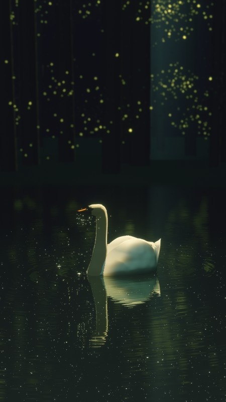
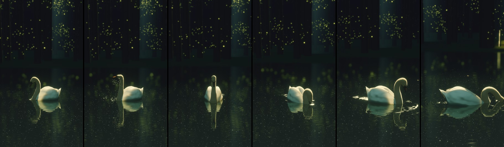
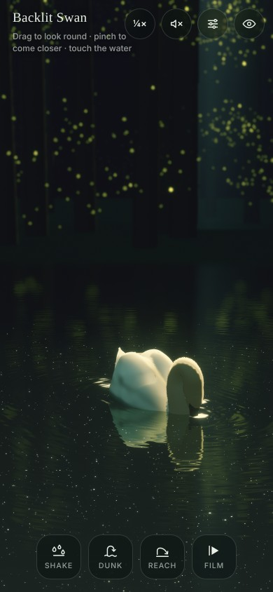
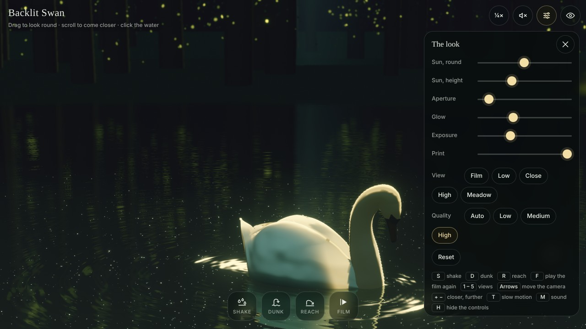

# Backlit Swan

A mute swan on a small, dark forest pond, lit from behind by low sun: an
interactive real-time scene built with three.js. It is a recreation of eleven
seconds of film, measured frame by frame and rebuilt as models, shaders and
simulation, so that it can also be seen from where the film never went.



It opens by playing the film's performance with the film's camera: the swan
drips, shakes the water off its bill, turns through the light, dunks, lifts
its head, and reaches down again. Then it is yours.



## What you can do

| | |
| --- | --- |
| Drag | move the camera round the swan and up and down |
| Pinch, or the wheel | come closer, back off |
| Touch the water | a drop falls there; the swan comes over and feeds |
| Touch the swan | it shakes its head |
| Double tap | back to the film's view |
| **Shake**, **Dunk**, **Reach** | what the swan does in the film, on request (`S`, `D`, `R`) |
| **Film** | the whole performance again, with its camera (`F`) |
| ¼× | slow motion (`T`) |
| Speaker | generated sound: air in the trees, water, drops landing (`M`) |
| Sliders | the look panel: sun direction and height, aperture, glow, exposure, the print; views (`1` to `5`); quality |
| Eye | hide the controls (`H`) |

It is laid out for a phone held upright (the shape of the film), for a phone
on its side, and for a desktop window.

| | |
| --- | --- |
|  |  |

## How it is made

Everything is generated in code: there are no model, texture, font or audio
files.

- **The swan** is a lofted body, a neck posed from eight bend angles in the
  vertex shader, a head and bill, a fringe of down, and the handful of
  feather shapes the film shows. Its glow is light going through it: the
  shader follows each sun ray through a stand-in for the bird and absorbs it
  by the length of feather it crosses, blue first. Thin parts come out cream,
  thicker parts a dimmer, slightly warmer cream, the thick middle is left to the blue of the sky.
- **The water** is a real mirror image (the scene drawn again from below),
  looked up along the reflected ray through a simulated ripple field plus
  finer analytic ripple trains. Glints are the sun in facets tilted just so,
  which only disturbed water has. Thousands of specks (7,000 to 16,000, by quality) float on it.
- **The surroundings** are drawn small into their own layer and defocused as
  one, which is all the depth of field there is: the subject stays sharp and
  nothing bright leaks into the blur.
- **The picture** is rendered in linear light with nearly neutral colours;
  the film's teal-olive-cream look is one curve per channel, fitted to the
  film's own pixels.

The details, with their limits, are in [docs/](docs/).

## Run it

```bash
npm install
npm run dev        # http://localhost:5180
npm run build      # a static site in dist/
```

## Docs

[docs/README.md](docs/README.md) is the way in: the design and its
measurements, what the build does, how the tricky parts work, the swan, the
tools and tests, and what has and has not been verified.
