# Backlit Swan: documentation

What the demo is meant to be, what it actually does, and how the unusual
parts work. Written for whoever changes it next.

| Document | What it answers |
| --- | --- |
| [design.md](design.md) | What is this, and what was measured from the film it recreates? The scale, the light, the grade, the swan's form and performance, the water, the surroundings. These are the targets. |
| [spec.md](spec.md) | What does the build do, exactly? Controls, the film's timeline, the swan's behaviour, the numbers of the look, the quality tiers. |
| [techniques.md](techniques.md) | How do the tricky parts work: light through feathers, the posed neck, the rippled mirror, glints, specks, depth of field, the print curve, the film's camera. Each with its limits. |
| [swan.md](swan.md) | The swan: its dimensions, its meshes, its pose, its shader, and how to change them. |
| [engine.md](engine.md) | The frame: every pass and target, the shared context, how to write a material, what is easy to break. |
| [tools.md](tools.md) | The dev scripts: tests, screenshots, URL parameters, and what has and has not been verified. |
| [ideas.md](ideas.md) | What to do next, roughly in order of value. |

## Keeping this current

These documents describe the code as it is. They are only worth having while
that stays true, so the rule for every change is:

1. **Change the docs in the same commit as the code.** A number in `spec.md`
   that no longer matches `src/` is a bug. New trick: add it to
   `techniques.md`. Idea done: move it out of `ideas.md`.
2. **Regenerate the pictures after any visual change.** One command remakes
   every image the README and these documents use:

   ```bash
   npm run dev                       # in another terminal
   node tools/screenshots.cjs        # writes docs/images/*.jpg and public/og.jpg
   ```

   The pictures are staged by the script (fixed moments of the film, seeded
   randomness, fixed cameras), so a re-run changes only what really changed.
3. **Run the tests** in [tools.md](tools.md) before pushing.

## The pictures

All in [`images/`](images/), all made by `tools/screenshots.cjs`.

| | |
| --- | --- |
| 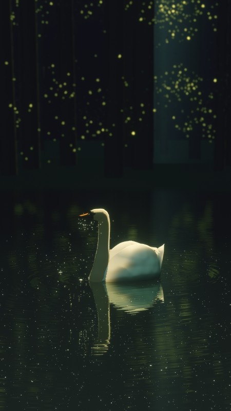 The shake, 1.3 s into the film | 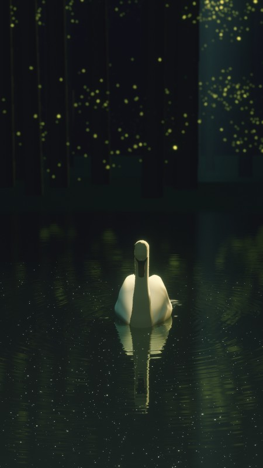 Head-on at 3.75 s: the two wing lobes either side of the neck |
| 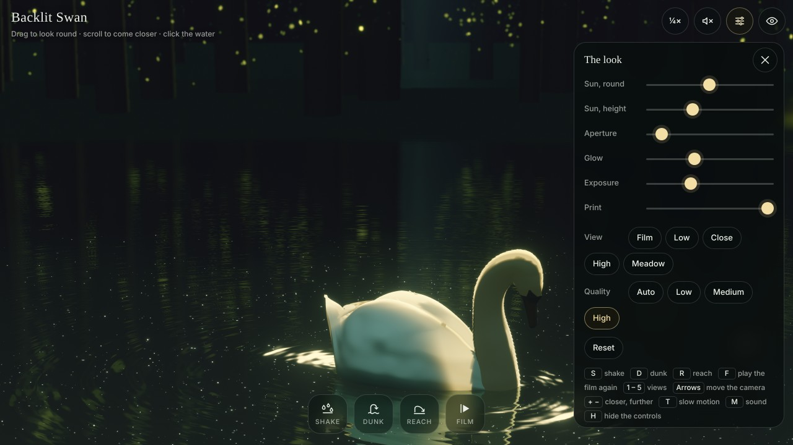 On a desktop, with the look panel open | 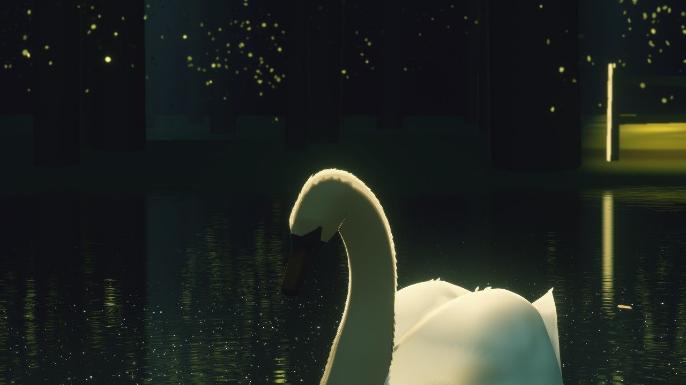 Close: the fringe of down along the neck, light through the tail |
| 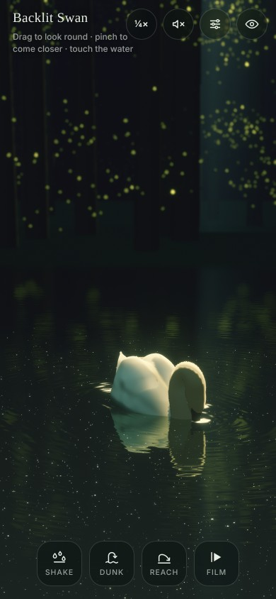 On a phone held upright | 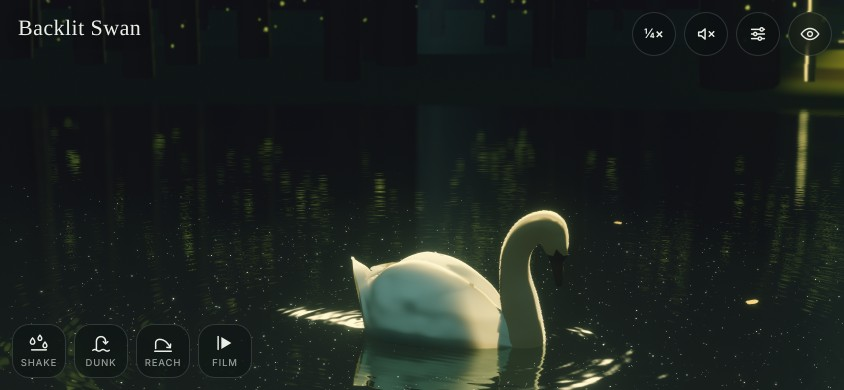 On a phone held sideways |
| 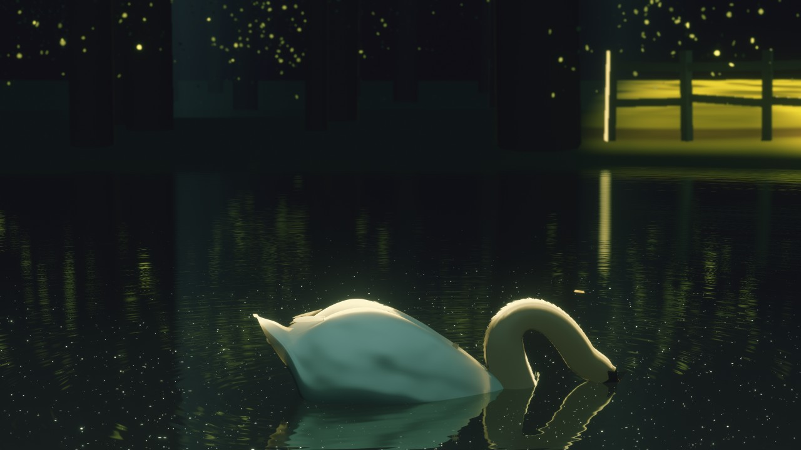 The reach, bill in the water | 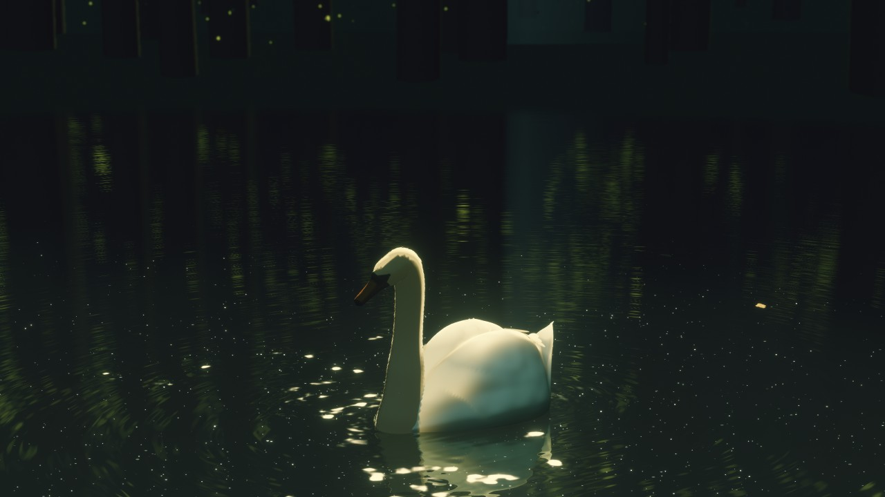 The spray landing: glints only where the water is disturbed |
| 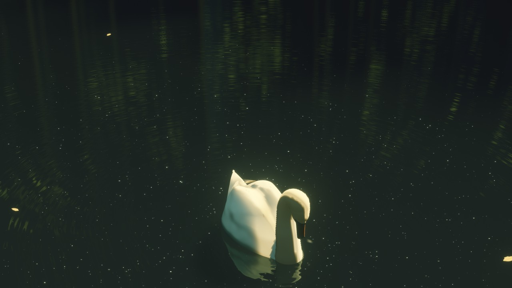 From above, as the swan comes up from the dunk | 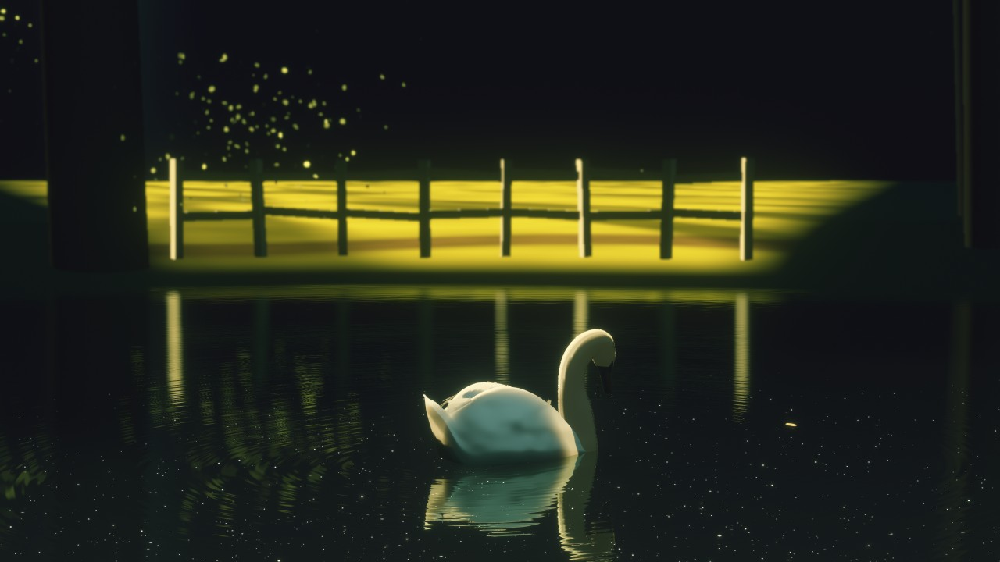 Toward the meadow and the fence |
| 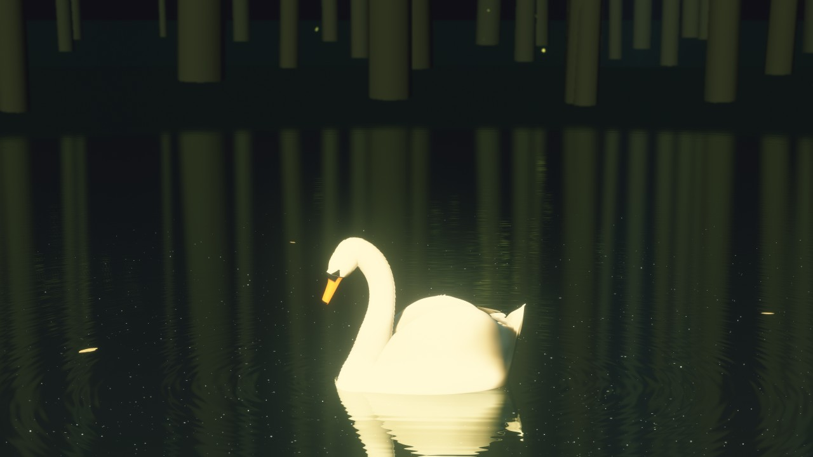 From the sunny side, where the film never went | 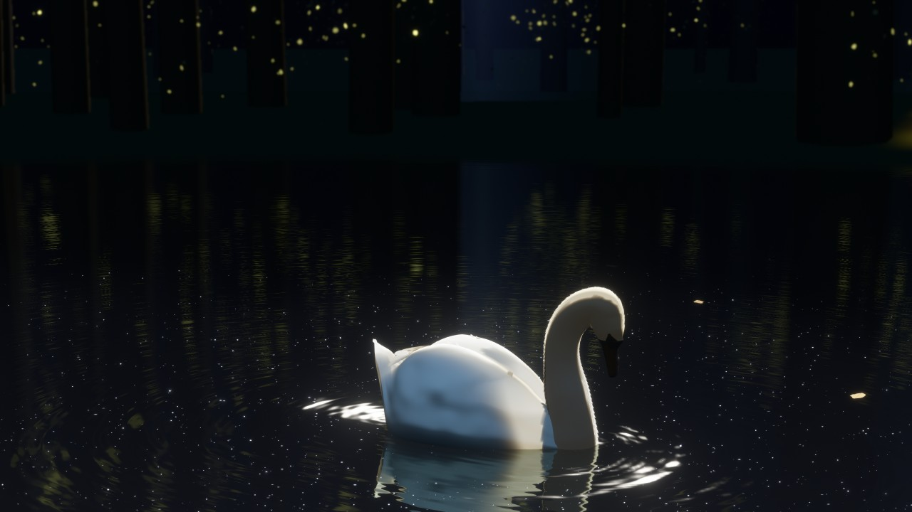 A frame before the print curve |
| 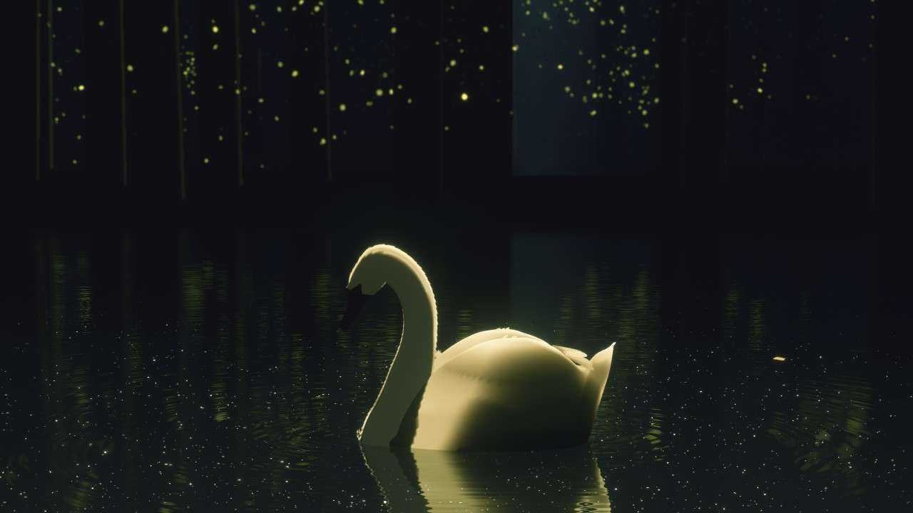 The sun alone: light that has crossed the bird | 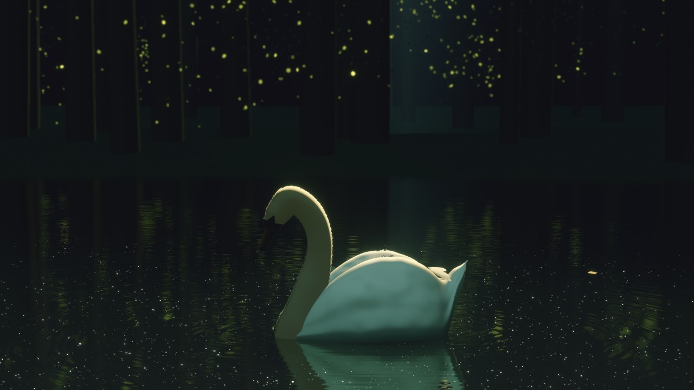 Without transmission: the sky and the rim |
| 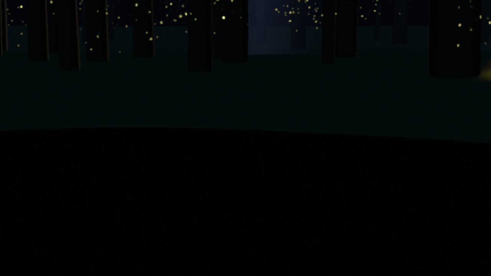 The far layer: drawn small, defocused as one | 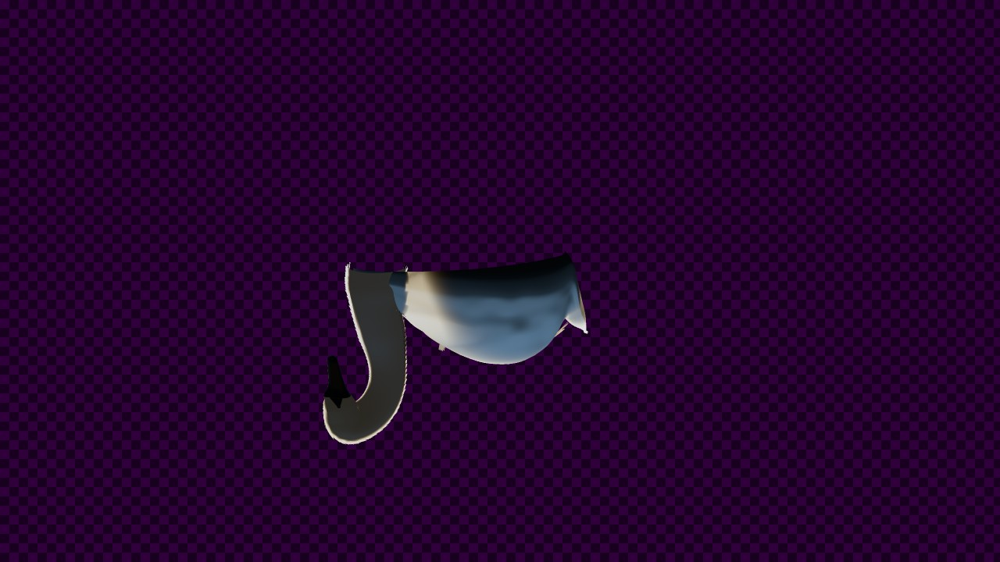 The mirror picture of the swan |
| 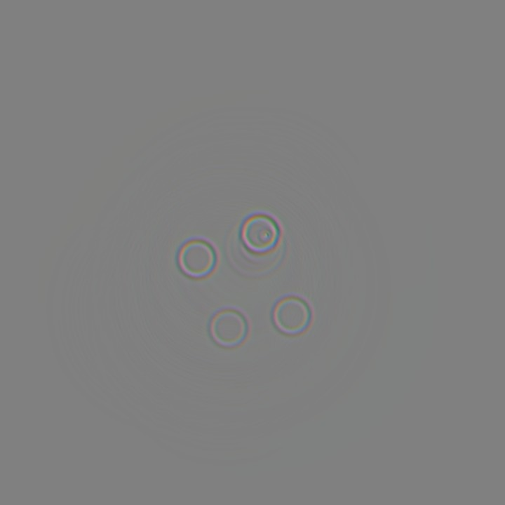 The ripple field, a moment after four drops have landed round the swan | |

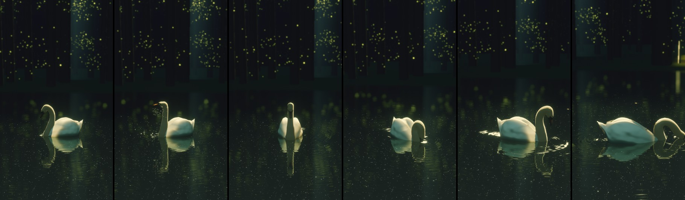
The film: drips, the shake, the turn, the dunk, up again, the reach.
