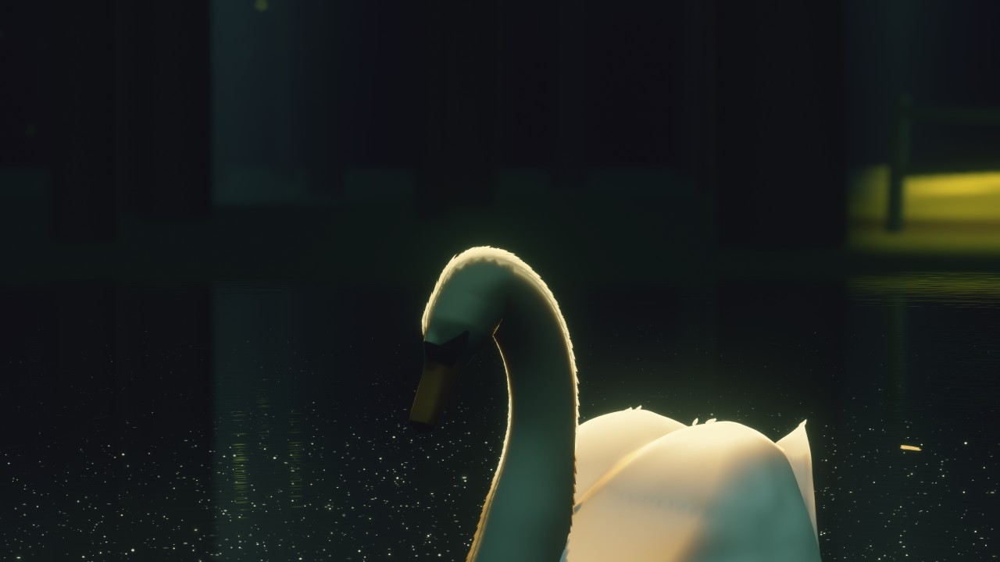

# The swan

How the bird is built, and how to change it. Why it takes the light the way
it does is in [techniques.md](techniques.md#2-light-through-the-bird); what
it does is in [spec.md](spec.md).



## The files

| file | what is in it |
| --- | --- |
| `assets/swan/anatomy.js` | Every dimension, measured from the film. The only copy. |
| `assets/swan/poses.js` | The pose's fields, the film's seven neck shapes, the solver that turns a pose into 49 rings. |
| `assets/swan/body.js` | The body mesh, built twice: wings arched and wings relaxed. |
| `assets/swan/neck.js` | The neck, head and bill as one skin, and the fringe of down. |
| `assets/swan/feathers.js` | The few feathers that show as shapes. |
| `assets/swan/material.js` | The shaders: placing the vertices, and how a feather takes the light. |
| `assets/swan/Swan.js` | Puts them together: three meshes, one set of uniforms, `update()`. |

## Dimensions (`anatomy.js`)

Everything is in `L`, the length at the waterline (0.60 m), in the axes the
measurements were taken in: `u` from where the breast meets the water (0)
toward the tail (1 at the stern's waterline, 1.125 at the tail's tip), `v` up
from the water, `w` across. The model's own space ("bird space", metres) has
+Z the way the swan faces, +Y up, +X to its left, and its origin on the water
under the middle of the body; `birdZ(u)` converts.

- **The body** is a set of cross-sections along `u`: `station(u, lift)` gives
  the outline's height and half-width there for a wing lift of 0 (relaxed) to
  1 (arched), and `sectionPoints` the section itself, a dome with the two
  wing lobes and the valley along the spine. The body mesh, the feather
  shapes and the shader's stand-in all read these.
- **The neck** is 0.95 L long with a radius profile `neckRadius(s)`: 0.13 L
  across for most of its length, flaring where it enters the water. It starts
  0.06 L under the surface (`NECK_SUNK`), so there is always neck below the
  waterline for the water to cut.
- **The head** is 0.29 L from the back of the skull to the tip of the bill
  (`HEAD_LENGTH`), with the bill beginning at 0.12 (`BILL_START`), the knob
  at 0.128 (`KNOB`) and the eye at 0.082 (`EYE`).
- **The bow** drops by up to 0.115 L (`BOW_DROP`) over the front of the body
  when the swan reaches down, and the body lengthens by up to 20 %
  (`BODY_STRETCH`). The tail swings about a hinge at the saddle
  (`TAIL_PIVOT`).
- **The stand-in** for the light (`proxyShapes(lift)`): six ellipsoids with
  densities relative to plain feather. The loose plumage is a hollow shell
  0.07 L thick; the wings are denser the flatter they lie (1.6 arched, 3.2
  relaxed) and fade in behind a slanting line, their leading edge; the body
  proper sits low and aft at density 3; the tail is thin. The neck and head
  are a chain of cylinders at 0.95 of their real radius.

Change a number here and the mesh, the feathers, the light and the animation
all follow. To check a change, stage the bird with the URL (below) and
compare with the film's proportions in [design.md](design.md).

## The pose (`poses.js`)

| field | meaning |
| --- | --- |
| `neck[8]` | Bend of each eighth of the neck, base first, radians. Positive curls it forward and down. |
| `lean` | The direction in which the neck leaves the body, radians from straight up, positive forward. |
| `bill` | Pitch of the bill below the horizontal, in the world: 0 level, 1.57 straight down. The top of the neck bends by whatever is needed to reach it. |
| `turn`, `turnAt` | The head and the top of the neck turned about the neck's own axis (±1.57 are the extremes of the shake), and where along the neck the turn happens: below a bend it swings the whole arch round, near the head it only rolls the head. |
| `sway`, `look` | The whole neck bent sideways; the head turned sideways on its end. |
| `stretch` | Length of the neck (1 is 0.95 L). A stretched neck is thinner. |
| `bow` | 0 to 1: the front of the body down. |
| `wingLift` | 0 relaxed (back 0.43 L high) to 1 arched (0.51 L high, 0.66 L across). |
| `bodyStretch`, `tail`, `breath` | The body lengthened, the tail lowered or cocked, breathing. |

`POSES` holds the film's seven shapes, each fitted to the neck's centre line
measured at that moment:

| | film time | shape |
| --- | --- | --- |
| A | 0.3 s | the proud S, bill 62 degrees down |
| B | 1.2 s | stretched tall, bill level (the shake happens in this one) |
| C | 2 to 4 s | a straight column, head hung over the top |
| D | 4.75 s | arching over on the way down |
| E | 5.5 s | a tight hook, bill in the water just ahead of the breast |
| G | 7.5 s | upright but bowed, wings relaxing |
| F | 10.5 s | the long low arch, bill in the water 0.3 L ahead, front of the body down |

`blendPose(out, a, b, t)` blends two poses field by field, `mixPoses` several;
`solveNeck(pose, solution)` writes the rings; `measurePose(pose)` says where a
pose would put the bill tip and the head without posing the swan.

## The meshes

- **Body** (`body.js`): a skin over the cross-sections, 44 to 112 stations
  long by tier, with both wing positions stored in every vertex so the vertex
  shader can slide between them. The soft billows of the folded wings are in
  the mesh: the skin is pushed in and out by a few millimetres of smooth
  noise, and the normals are taken from a version pushed twice as far, so
  that the sky's light picks out the upper edge of each billow without the
  outline going lumpy. The feather shapes are part of this mesh.
- **Feathers** (`feathers.js`): small flat blades and two rounded lumps, in
  the five places the film shows them and nowhere else: saw-tooth tips at the
  tail's point, two lobes on its rear edge, the wing tips over the tail base
  with two slits between them, a few crossed tips on the crest, and one
  upright tuft on the right side of the forward slope.
- **Neck, head and bill** (`neck.js`): one skin whose vertices name the ring
  they ride on. The bill, the knob, the nail, the lores and the eye are not
  separate parts but regions of the head's surface, coloured in the fragment
  shader from the position in the head's own axes: orange bill, black knob,
  nail, lower mandible and lores, a dark glossy eye.
- **Fringe** (`neck.js`, `buildFringe`): 16 to 36 strips standing radially
  along the neck and head, cut into beads and saw teeth in the fragment
  shader.

Three draw calls in the main picture and three in the mirror.

## Staging the bird for a picture

The URL can hold the swan still in any shape and heading:

```
?still&heading=10&pose=A            side-on facing left, the proud S (the film at 0.3 s)
?still&heading=92&pose=C            head-on
?still&heading=172&pose=F&az=16&el=11&dist=3.4      the reach, from where the film ends
&turn=60 &look=20 &bill=10 &sway=5  degrees, written over the pose
&wing=0 &bow=1 &stretch=1.05 &bodystretch=0.8 &tail=-0.5
```

`heading` is the film's: 0 side-on facing the left of the default picture, 90
facing the camera, 180 facing right. Add `&az= &el= &dist=` for the camera
(it stays on the swan) and `manual` to stop the clock.

## Changing things

- **A proportion**: `anatomy.js`. Then look at `?still&heading=10&pose=A`,
  `heading=92&pose=C` and `heading=172&pose=F`.
- **A neck shape**: the eight bends in `POSES`. The solver is cheap enough to
  fit them to a drawn centre line by trial.
- **How it takes the light**: the `swan…` values of `LOOK` in
  `scene/config.js` are live (`__swan.set('look.swanThrough', 0.3)` in the
  console): the free path of light in feather, the absorption ratios, the
  shares that leave through the body's and the neck's shadow side, how much
  sky each part gets. The stand-in's shapes and densities are in
  `proxyShapes`. Turn the sky off (`look.skyColor` to zero) to see the sun's
  part alone, or the transmission off (`look.swanThrough` and
  `look.swanNeckThrough` to zero) to see the rest.
- **The fringe**: `look.swanFringe` (how far the down stands off, metres) and
  `look.swanFringeBend`.
