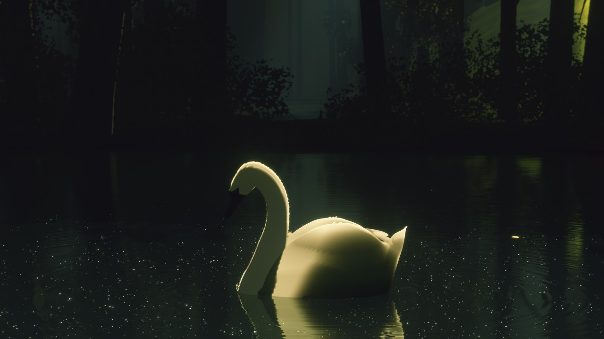
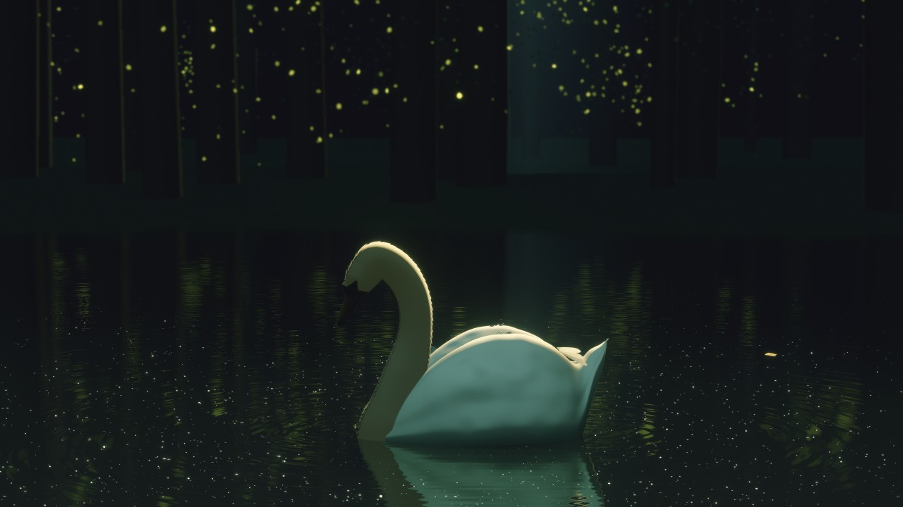
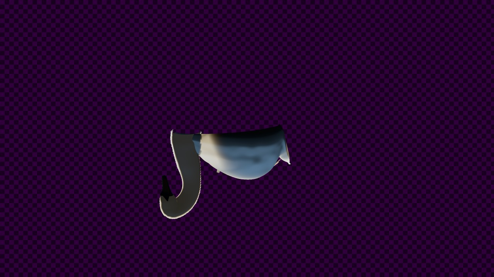
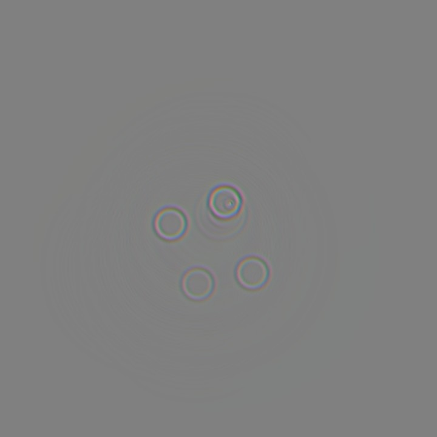
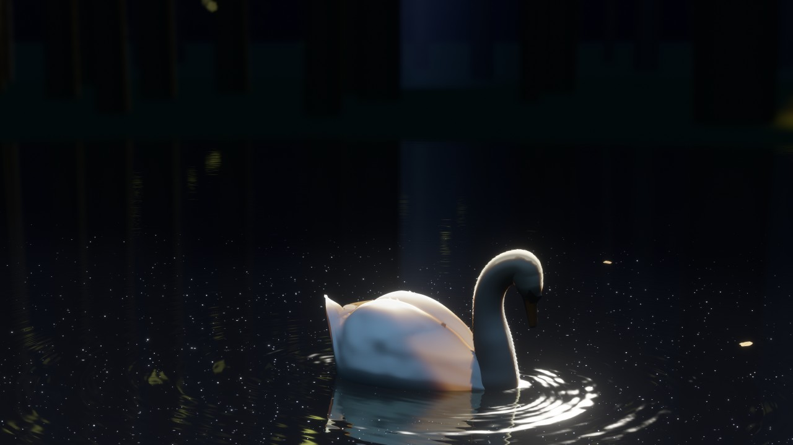
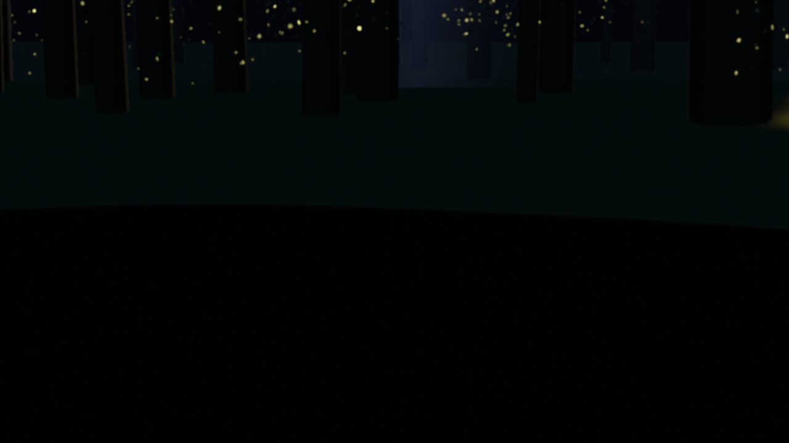

# Backlit Swan: how the tricky parts work

One section per trick: what it is for, how it works, where it lives, and
where it stops being true. The frame as a whole (every pass and target) is in
[engine.md](engine.md); the swan's construction is in [swan.md](swan.md).

## 1. Measure first

The demo is built to numbers taken from the film rather than to an
impression of it: positions tracked frame by frame, drops fitted to
parabolas, pixels sorted and averaged, glow profiles fitted with Gaussians.
The numbers are in [design.md](design.md). Three of them changed what was
built:

- **Falling drops accelerate at 17.8 body lengths per second squared.** With
  real gravity that makes the swan's waterline 0.55 m, which is a real
  swan's. So the film is not slow motion, and nothing here is slowed.
- **The swan grows 35 % in the picture while the background does not zoom.**
  So the camera is close (5 m) and the lens is not long: a 37 degree upright
  field of view.
- **Hue depends only on brightness.** So the scene can be lit neutrally and
  the whole grade is one curve per channel (section 9).

## 2. Light through the bird

*`assets/swan/material.js`, shapes in `assets/swan/anatomy.js`
(`proxyShapes`).*

The film's glow is not a rim light. Thin parts of the bird (tail, wing tips,
the taper of the bow) are bright cream, slightly thicker parts amber, and the
thick middle gets no sun at all. That is absorption along the light's path,
so that is what is computed:

- A stand-in for the bird is kept as six ellipsoids (the loose plumage as a
  hollow shell: one ellipsoid with a smaller one of negative density inside
  it; the two wings, whose density fades in behind their leading edge; the
  dense body low and aft; the tail) and a chain of nine cylinders down the
  neck and head.
- For every vertex, the shader follows the ray from that point toward the sun
  and adds up density times length inside each shape. Ray against ellipsoid
  and ray against cylinder have closed forms, and so does a density that
  fades linearly behind a plane.
- The light that arrives is `exp(-absorb * depth)` per channel, with blue
  absorbed 2.3 times and green 1.45 times as fast as red: a little depth
  gives cream, more gives amber, more gives nothing.
- A surface facing away from the sun shows a share of that light (0.32 on the
  body, 0.08 on the close-feathered neck and head); a surface facing the sun
  shows the larger of that and plain wrapped sunlight.
- Everything else is the sky: a blue fill, strongest on surfaces tilted up,
  weak on vertical ones and near the water, a third as strong on the neck.
  The print curve turns it teal.

Because it is one sum over shapes that move with the pose (the neck's
cylinders are the solved neck; the wings' densities depend on how far they
are raised), the glow moves correctly when the bird turns, bows or relaxes
its wings, and when the sun is moved. Nothing is painted on.

 

**Limits.** The stand-in is not the mesh: where they differ by more than a
couple of centimetres (the neck's base, the wing's leading edge) the lit
region's edge is in a slightly different place from the silhouette's. Depth
is per vertex, so its detail is the mesh's. It is single scattering with a
fixed share for the shadow side, not a simulation of light diffusing in
feathers: the cream zone is a little more sharply bounded than the film's.
The interpolated depth is clamped at zero in the fragment stage, because on
a multisampled edge it is extrapolated past the triangle and a negative
depth would amplify the light.

## 3. A neck posed in the vertex shader

*`assets/swan/poses.js` (solver), `assets/swan/neck.js`, `material.js`.*

A pose is eight bend angles for eight stretches of neck, the angle at which
it leaves the body, the bill's pitch in the world, a turn about the neck's
own axis and where along the neck that turn happens, a sideways sway, a
sideways look, a stretch, and a few numbers for the body (bow down, wings
lifted, body lengthened, tail, breath). The solver integrates the bends into
49 rings, each a position and an orientation, in a few microseconds. Every
vertex of the neck, the head and the fringe names the ring it rides on; the
vertex shader interpolates the two nearest rings and puts it in place.

So a new pose costs about 600 numbers uploaded and no per-vertex work in
JavaScript, in the main picture and the mirror alike, and no vertex buffer is
written after start. Blending two poses is blending their numbers, which is
how the film is played: 20 keys naming shapes, eased from one to the next.

**Limits.** The film's seven shapes were fitted to centre lines measured from
the film and pass within 0.02 L of them; shapes between them are plausible,
not measured. The neck cannot cross itself or the body: nothing checks.

## 4. The fringe of down

*`assets/swan/neck.js` (`buildFringe`), `material.js` (`FRINGE`).*

The bright line round the film's neck is lit down standing off the outline:
beads on straight runs, a saw on the outside of a bend. It is 16 to 36 thin
strips standing radially along the neck and head. The fragment shader cuts
each into teeth by its distance along the neck (rounded where the neck is
straight, sharpening with the local bend, which the solver supplies), fades
strips that point at the eye so only the ones seen edge-on show, and lights
each tooth by the light at its foot. Where the target is multisampled the
cut-out uses alpha-to-coverage.

**Limits.** Seen from very close the strips are flat. On the low tier (no
multisampling) the teeth are alpha-tested and rely on the final edge
smoothing.

## 5. A mirror, looked up along the reflected ray

*`engine/PlanarMirror.js`, `assets/pond/Water.js`.*

The swan is drawn a second time from a camera mirrored in the water plane
(with the near plane slanted into the surface so nothing under water shows),
into a picture with alpha. That picture is not pasted on. For each pixel of
water the eye ray is reflected about the rippled surface there and followed
as far as the swan stands, and that world point is projected into the mirror
picture and read. Flat water gives the exact mirror image. Tilted water
lands somewhere else, further off the taller the thing reflected, and because
the water is seen from 10 degrees above, a tilt toward or away from the eye
moves the image about six times as far as the same tilt sideways.

That one construction gives everything the film's reflection does: sharp, the
right height, fraying at its lower edge, breaking into horizontal slivers and
closed loops under the reflected head. Nothing is blurred or stretched on
purpose. The surroundings are looked up the same way, further along the ray,
in a defocused mirror picture of the far layer, and the swan is laid over
them by its alpha.

**Limits.** One reflection distance per pixel: a ripple cannot show the
swan's head and the far bank in the same pixel. Things in the mirror picture
are opaque or additive; nothing refracts.

## 6. Ripples at three scales

*`engine/RippleField.js`, `assets/pond/Water.js` (`TRAINS`),
`assets/pond/surface.js`.*

- **Simulated**: a window of water 8 m across that follows the swan, 256 to
  512 texels wide, stepped as a wave equation on the GPU (ping-pong targets,
  fixed substeps). Drops, the bill and the hull dent it; the dents become
  rings. Its texels are 1.6 to 3 cm, so it carries waves of about 9 cm and
  up. The window moves by whole texels and the state is shifted to match, so
  the water stays where it was in the world.
- **Analytic**: the film's fine ripple is 4 to 5 cm long, too small for the
  grid. Seven wave trains 3.8 to 13 cm long are written as formulas: rings
  that radiate from the swan, turned into shallow spirals so that they cross
  each other, their phases warped so that crests are not perfect arcs, and
  the short ones gathered into packets so that they show as dashes. Each
  train's speed is what water of that length does (gravity and surface
  tension). Where a wave is smaller than about two pixels its slope is faded
  out rather than left to alias.
- **Agitation**: a splash is not a smooth dent. The field carries a fourth
  number per texel, how broken up the water is below what the grid can show.
  It is raised by disturbances and by the hull passing (a gliding swan is
  slower than the slowest ripple, so it leaves churned water, not a V), and
  dies away in about a second. It scales the fine trains up and roughens the
  surface for the sun (section 7).

**Limits.** The simulation's waves all travel at one speed (no dispersion):
event rings do not spread into a train of different wavelengths. Outside the
8 m window there are only the analytic trains. The fine trains are centred
on the swan, so a second disturbance far from it has rings but no fine
ripple of its own.

## 7. Glints only where the water is disturbed

*`assets/pond/Water.js`, section 5 of its shader.*

A patch of water throws the sun at the eye when its slope is the one halfway
between the two directions. With the sun 32 degrees up and the eye 10, that
slope is about 0.19; calm water has 0.01. So calm water shows no sun, which
is the film. The share of a pixel tilted just so is a bell over the
difference between the slope needed and the slope there, as wide as the
roughness: a little always, plus the fine ripple too small to draw, plus the
agitation. A fresh splash is rough nearly all over and shows a blown-out
patch, wider than tall because the water is seen so flat; as the agitation
dies away what is left is rows of thin level dashes on the faces of the
ripples that look away from the swan. The patch is many times over the
exposure and blooms.

**Limits.** The sun's own image in calm water appears if the camera is raised
toward the sun's height (above about 25 degrees with the default sun): right
for open water, though this sun is meant to come through trees. The sun is
given a width so that the image is a soft patch, not a needle.

## 8. Specks that hold their density

*`assets/pond/Specks.js`.*

The film has as many specks per patch of picture near the lens as far from
it. That is debris of every size, each bit visible from as far as its size
allows. So every speck has a range and a size in proportion to it; small
ones are many and show only close to the lens. Each repeats across the water
in a square of its own (0.4 of its range) and is drawn once, at the copy
nearest the water in view, fading toward the edge of its square and toward
its range, so the hand-over to the next copy is never seen. The sheet drifts
as one. A speck is lit by the sun or it is almost nothing: none in the
wood's shadow (`sunReach`), few in the swan's. It is a point on the surface:
it rides the ripples, is never smaller than about 1.3 pixels, has no mirror
image, and the swan hides it. A fifth are flat and show as short level
dashes; a few are golden leaves.

**Limits.** Up to 16,000 points on the high tier, drawn every frame. Specks
do not part round the swan or pile up at the shore.

## 9. The print: one fitted curve per channel

*`engine/PostChain.js` (`printCurve`).*

Sorted by brightness, the film's pixels have one mean colour per brightness:
blue-black, teal, olive, warm, cream. Three curves fitted to that table (to
within 1 to 4 code values) take the tone-mapped, sRGB-encoded picture to the
screen. Black comes out as a blue-violet 5 to 7 %; white as cream, with blue
never reaching the top. Because the curve acts after the glow is added, the
glow round a hot edge shades from cream through olive to nothing by itself,
as measured in the film. The scene is therefore lit almost neutrally: a sun
of 1 : 0.95 : 0.86 and a blue sky.

**Limits.** It is the mean colour per brightness, so the film's saturated
exceptions (the yellow meadow) have to be lit that way in the scene. The
curve is applied to each channel separately, which shifts hue a little in
saturated colours; that is part of the look here but would not suit another
scene.

## 10. Depth of field by layers

*`engine/FarLayer.js`.*

Everything well behind the swan (the wood, the bank, the meadow, the haze) is
drawn into its own small target and blurred with a disc kernel whose radius
is the aperture, then used as the backdrop of the main picture. Leaves many
times brighter than white become soft blobs of light. The subject layer is
never blurred, and nothing bright from it can leak into the blur, which is
the usual failing of a depth-of-field pass round a backlit edge. The same
layer is drawn again from the mirror camera for the water to reflect.

**Limits.** One blur for the whole far layer, whatever its distance, and none
in front of the swan: near water and near specks are sharp. The blur does not
follow the lens when the camera is brought closer.

## 11. The glow

*`engine/PostChain.js`.*

A pyramid of progressively halved pictures, each filtered with 13 taps on the
way down and a tent on the way up, weighted per level so that a tight glow
and a wide faint skirt are both there, added before the tone curve and the
print with no threshold (a lens glows for everything, in proportion).

## 12. Two operators

*`scene/Director.js`.*

While the film plays, the camera does not orbit the swan: it stands where the
film's operator stood and is aimed at the swan from there, the aim trailing a
little. That is why the background slides past as it does in the film and
why the swan grows as it approaches. The moment a person touches the camera
it becomes an ordinary orbit round the swan from wherever it was.

## 13. Pictures and tests that do not depend on the clock

*`engine/Engine.js`, `engine/rng.js`, `tools/`.*

With `?manual` nothing moves until `__swan.advance(seconds)` steps the scene
in fixed sixtieths of a second. All randomness comes from one seeded
generator with named streams; no code under `src/` reads the clock except
the engine's loop and the gesture handling. So `?manual&t=1.27` is the same
picture on every run, byte for byte, which the tests check and the
screenshot tool relies on.
