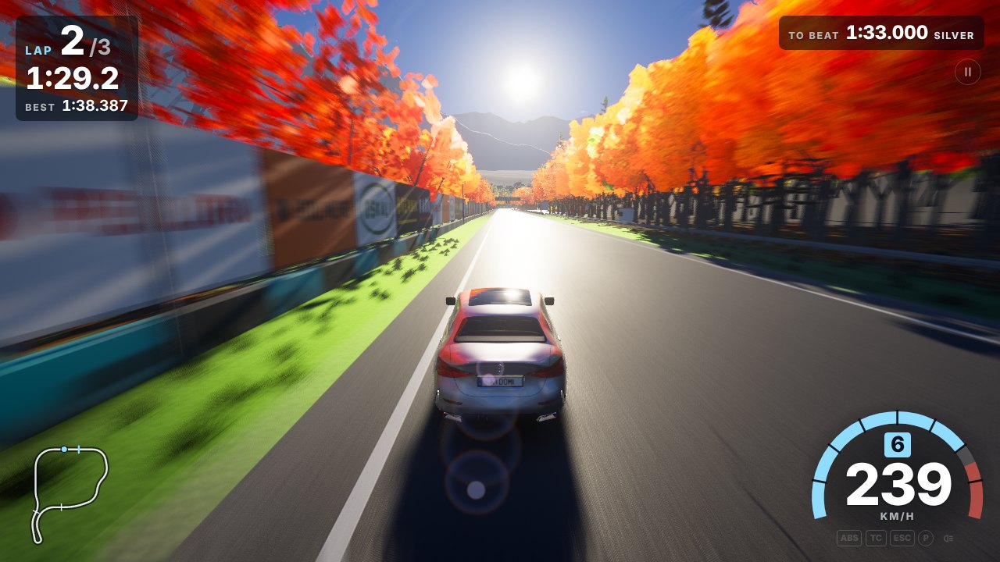
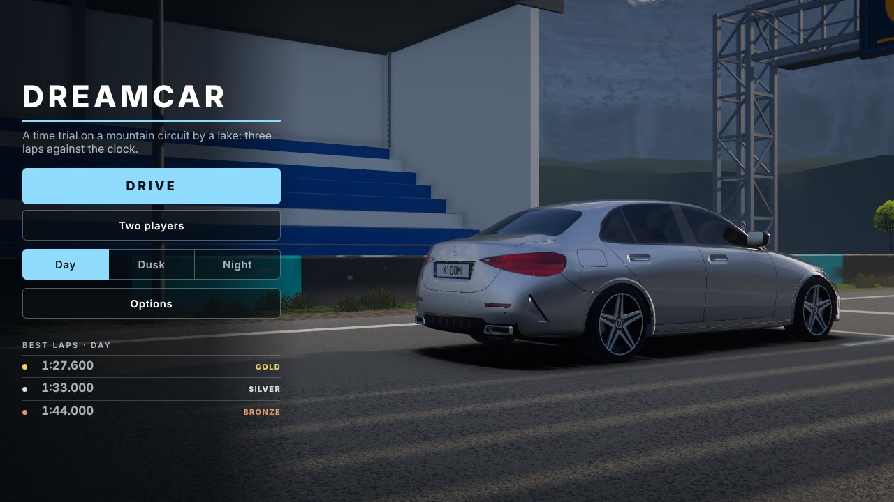
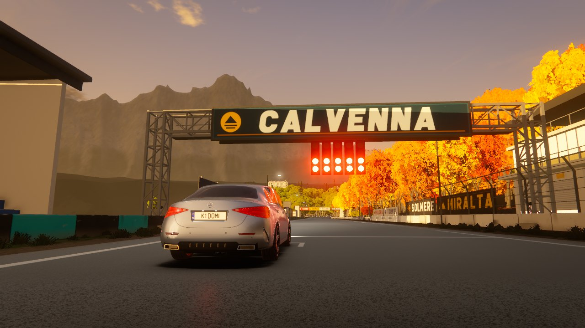
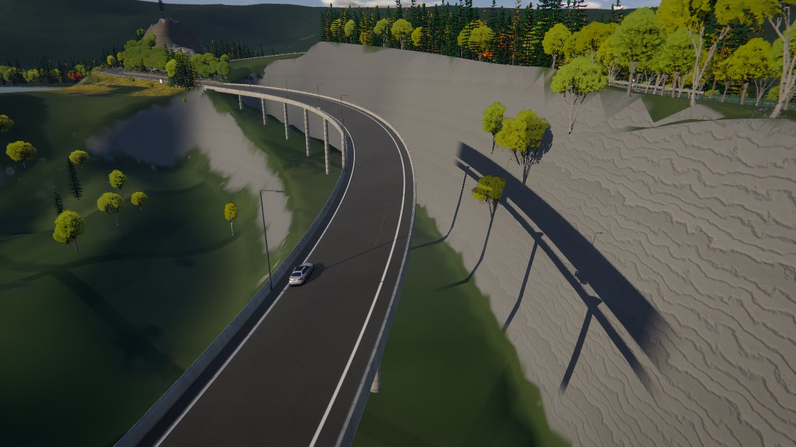
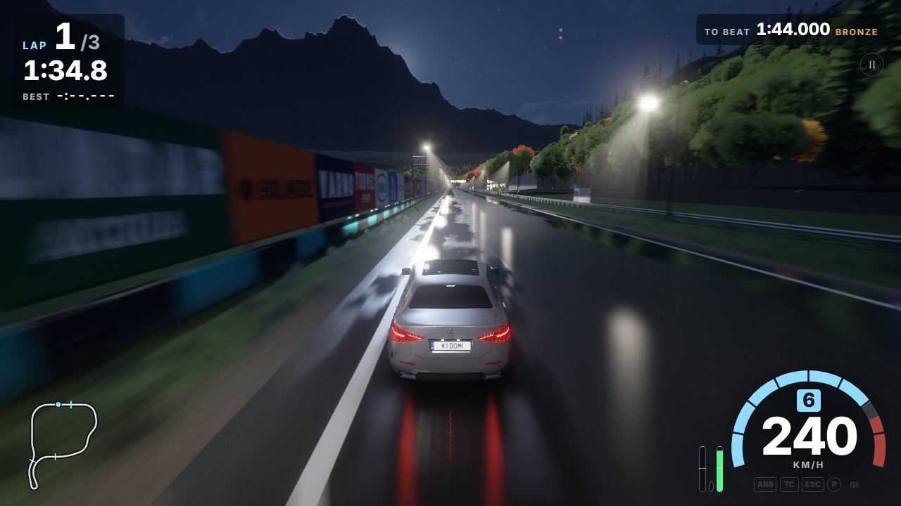
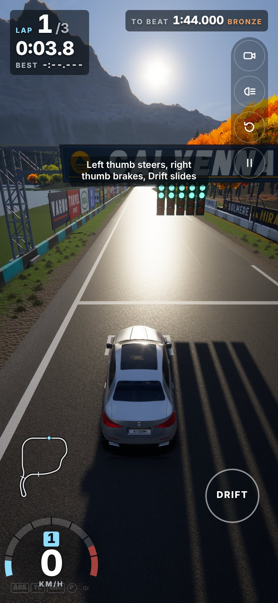
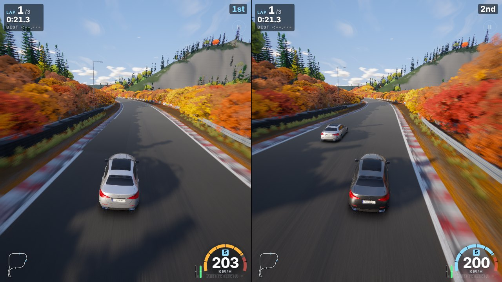

# Dreamcar

A time trial in a silver saloon on a racing circuit in the mountains by a
lake, built with three.js: three laps of 5.1 km against the clock, by day with
the sun straight down the start straight, at golden hour, and on a wet night.
Solo, or two players in split screen; keyboard, gamepad or touch, on a desktop
or a phone.



The circuit climbs 108 m from the lakeside straight through forest esses and
a lit tunnel, out onto a road on piers across the valley, round a slow
banked carousel, over a crest, down a plunge and a ledge, across a second
bridge and through a long right back to the shore. The car is a model of a
real one, made in code from photographs, in a hot dream tune: 0 to 100 km/h in
3.9 s, 284 km/h, about 1.3 g. It is quick and planted, and it can be driven
flat out with a keyboard or one thumb in the first minute.

| | |
| --- | --- |
|  |  |
|  |  |

Everything is generated in code: the car, the circuit, the forest, the sky,
the textures and the sound. There are no model, texture, font or audio files,
and nothing is fetched at run time.

## Controls

| | keyboard | gamepad | touch |
| --- | --- | --- | --- |
| drive, brake | W, S (or ↑, ↓) | right, left trigger | the car drives itself (or GAS, with Throttle: Manual); BRAKE, bottom right |
| steer | A, D (or ←, →) | left stick | the slider at the bottom left: its centre is fixed (or two arrows, in the options) |
| handbrake | Space | A | DRIFT, above BRAKE |
| camera | C | Y | button |
| look back | B | X | |
| put back on the road | R | B | button |
| high beam | H | | button |
| ghost of the best lap | G | | |
| time of day | N | Back | on the title |
| pause | P, Esc | Start | button |

Two players on one keyboard: W A S D and Space, the arrows and right Shift.
Quality (auto, low, medium, high), sound, units and the map are in Options on
the title and the pause sheet.

| | |
| --- | --- |
|  |  |

## Run, build, test

```bash
npm install
npm run dev               # http://localhost:5190
npm run build             # dist/, static, relative paths
npm run preview           # http://localhost:4190, the build

node tools/unit.mjs       # the road, the car's physics, the rules (Node)
node tools/handling.mjs   # the car's numbers
node tools/playtest.cjs   # the game in headless Chromium, against the preview
node tools/soundtest.cjs  # the sound, against the dev server
node tools/screenshots.cjs  # every picture of these documents
```

The browser scripts need Playwright available to Node (it is not a project
dependency). Developed and tested only in headless Chromium on software
WebGL: see [docs/tools.md](docs/tools.md) for what has and has not been
verified.

`?time=day|dusk|night`, `?mode=split`, `?q=low|medium|high`, `?plate=` and
more are listed in [docs/spec.md](docs/spec.md#url-parameters).

## Documentation

[docs/](docs/): the design, the spec in numbers, the techniques, the car, the
frame, the tools and what is next.

It is an original demo. An old open racing sample and a console racing
simulator were looked at for what good looks and feels like; nothing of
theirs (names, logos, HUD artwork, track shapes, scenery) is used. The car is
an unofficial model made out of enthusiasm for the real one; this project is
not affiliated with its maker.
