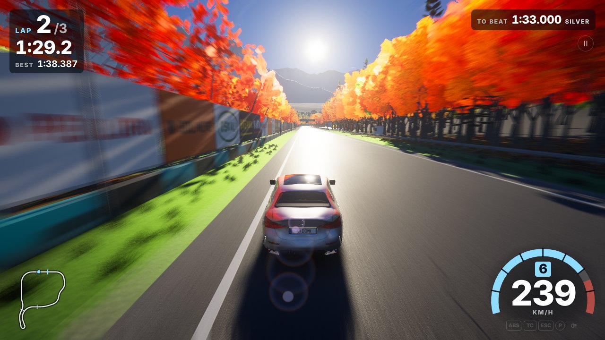
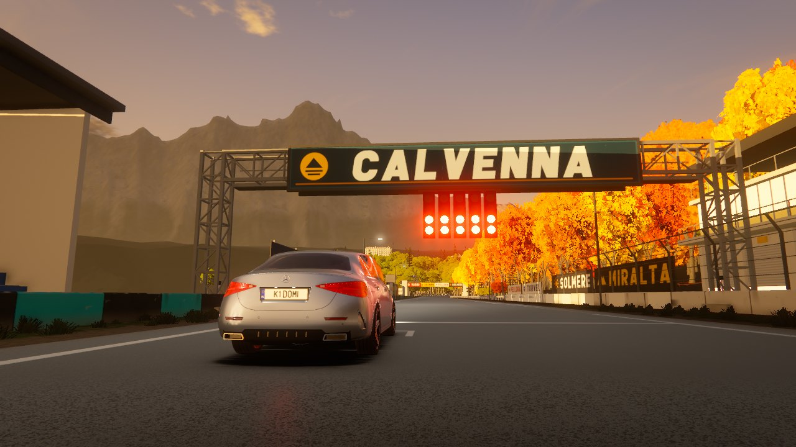
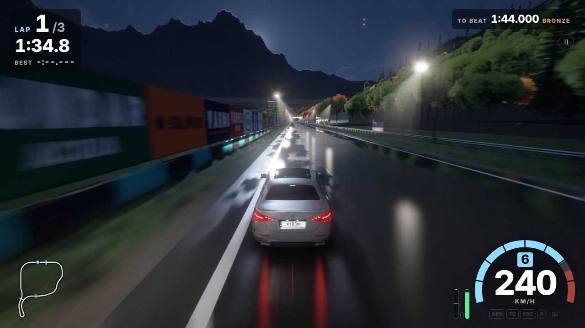
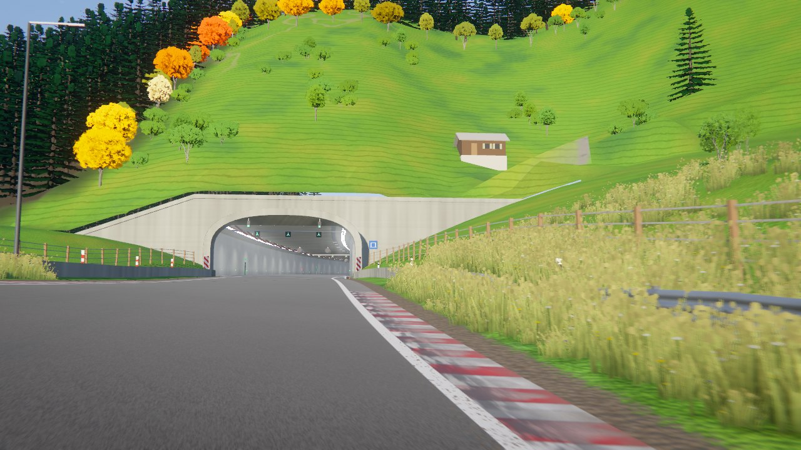
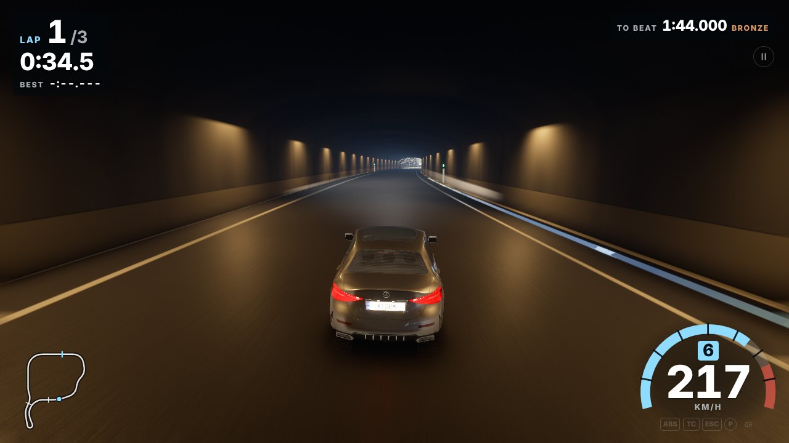

# Dreamcar: documentation

What the demo is meant to be, what it actually does, and how the unusual
parts work. Written for whoever changes it next.



| Document | What it answers |
| --- | --- |
| [design.md](design.md) | What is this meant to be? The car, the circuit, a run, how it should feel, the camera, the look of each time of day and the reference frames it answers to. These are the targets. |
| [spec.md](spec.md) | What does the build do, in numbers? The circuit section by section, the car and its handling table, the rules, controls, cameras, HUD, options, URL parameters, the times of day, the passes and tiers, sound, storage. |
| [techniques.md](techniques.md) | How do the tricky parts work: the Track from straights and arcs, the terrain conformed to it, the vehicle and why it runs in Node, the autopilot's speed plan, the trees, the sky and the massif, the asphalt, the frame, what each pass draws (the budget), the lamps at night, determinism, the staging camera. |
| [car.md](car.md) | The car: its files, how the skin, the paint, the glass, the lamps, the wheels and the plates are made, what each tier costs, what still differs from the photographs. |
| [engine.md](engine.md) | The frame: every pass and target per tier, the tone curve and the grade, the probe and the mirror, split screen, how to add a pass, what is easy to break. |
| [tools.md](tools.md) | The dev scripts: tests, screenshots, the page handle, and what has and has not been verified. |
| [ideas.md](ideas.md) | What still falls short of the reference frames, and what to do next. |

| | |
| --- | --- |
|  |  |
|  |  |

## Keeping this current

These documents describe the code as it is. They are only worth having while
that stays true, so the rule for every change is:

1. **Change the docs in the same commit as the code.** A number in `spec.md`
   that no longer matches `src/` is a bug. After changing the car, its tyres
   or the road, run `node tools/unit.mjs` and `node tools/handling.mjs` (and
   `node tools/trackmap.mjs out.svg` for the road) and bring spec.md up to
   date. New trick: add it to `techniques.md`. Idea done: move it out of
   `ideas.md`.
2. **Regenerate the pictures after any visual change.** One command remakes
   every image the README and these documents use:

   ```bash
   npm run dev                       # in another terminal
   node tools/screenshots.cjs        # writes docs/images/*.jpg and public/og.jpg
   ```

   Look at every picture it writes. If a staged camera no longer frames its
   subject, fix its pose in the tool's `LOADS` table.
3. **Keep "What has not been verified" in tools.md honest.**
